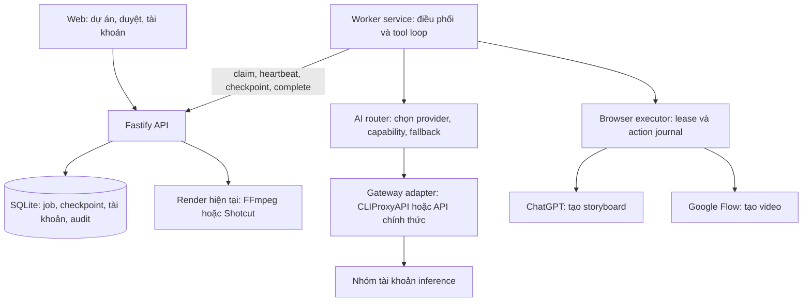

# Plan: nhiều provider, nhiều tài khoản và tiếp tục job khi hết quota

Ngày lập: 21/10/2026. Trạng thái: đề xuất để triển khai, chưa cài proxy, chưa đăng nhập tài khoản và chưa thay đổi runtime.

## 1. Mục tiêu và quyết định đề xuất

Người dùng đăng nhập nhiều tài khoản Codex, Antigravity và Claude mà mình có quyền sử dụng. Hệ thống chọn một tài khoản phù hợp; khi tài khoản đó hết quota, chuyển sang tài khoản khác còn dùng được và tiếp tục dự án từ trạng thái đã lưu.

Đề xuất kiến trúc: **backend hiện tại + worker chạy độc lập + gateway inference có thể thay thế + browser executor dùng chung**.

- Giữ Fastify, SQLite, web quản lý cảnh, phê duyệt và pipeline render hiện có.
- Đánh giá CLIProxyAPI đầu tiên cho nhóm Codex/Antigravity vì đã có nhiều provider và nhiều tài khoản.
- Không ghép cả năm proxy thành một chuỗi. Chọn một gateway chính; adapter cho phép thay gateway khi cần.
- Mặc định dùng một tài khoản cho đến khi cần chuyển, thay vì luân phiên mỗi request.
- Tách rõ chuyển tài khoản trong cùng provider và đổi sang provider/model khác. Đổi model chỉ xảy ra giữa các bước có checkpoint và theo cấu hình của dự án.
- Mặc định một browser executor hoạt động; có thể chờ nhiều lượt tạo video, nhưng các thao tác trên từng browser profile phải tuần tự.
- Claude subscription ưu tiên chạy qua Claude Code nguyên bản; inference Claude trong worker riêng ưu tiên API chính thức. Không lấy khả năng proxy đọc OAuth làm bảo đảm về quyền sử dụng.

**Điều kiện hoàn thành:** tài khoản A gặp quota ở một bước AI → ghi nhận nguyên nhân → chọn B hợp lệ → khôi phục ngữ cảnh cần thiết → tiếp tục cùng job; không mất cảnh, không tự duyệt lại prompt, không tạo video/ghi credit hai lần.

## 2. Những thứ phải phân biệt

| Nhóm | Ví dụ | Cơ chế cần có |
|---|---|---|
| Tài khoản inference | Codex, Antigravity, Claude | OAuth/API credential, model, quota, cooldown, routing |
| Model thực tế | Gemini hoặc Claude được cung cấp qua Antigravity | Model ID thực tế, capability và nhóm quota; không suy từ tên tài khoản |
| Tài khoản tạo ảnh | Phiên ChatGPT trên Chrome | Browser profile, cuộc hội thoại, ảnh đầu ra, hạn mức riêng |
| Tài khoản tạo video | Phiên Google Flow trên Chrome | Browser profile, project, generation ID/URL, credit riêng |
| Phiên IDE/CLI | Codex app, Antigravity IDE, Claude Code | Công cụ và lịch sử của host; không tự chuyển thành runtime thông qua proxy |

Đổi tài khoản Codex/Antigravity inference **không** đổi tài khoản Flow, không bổ sung credit Flow và không đổi phiên ChatGPT tạo ảnh. Ba nhóm hạn mức phải hiển thị riêng.

Proxy cung cấp inference; worker của autovideo chịu trách nhiệm vòng lặp tool call, đọc ảnh, upload, download, lưu checkpoint và gọi API hoàn thành job. Chỉ trỏ `base_url` vào proxy sẽ chưa thay thế được Claude in Chrome.

MVP xử lý tự động nhóm tài khoản inference. Pool tài khoản ChatGPT/Flow nằm ở giai đoạn sau, dùng browser profile tách biệt. Khi Flow hết credit ở MVP, giữ nguyên hành vi tạm dừng và báo người dùng, không đổi nhầm sang tài khoản inference khác.

## 3. Đối chiếu các repo được đề xuất

Phần người dùng gửi có tiêu đề/ảnh xem trước trỏ sang repo khác. Bảng này đánh giá theo URL GitHub thực tế. Các khả năng là theo tài liệu upstream tại ngày lập plan; chưa chạy thử trên tài khoản thật.

| Repo | Nhận xét và vị trí trong plan |
|---|---|
| [router-for-me/CLIProxyAPI](https://github.com/router-for-me/CLIProxyAPI) | Ứng viên gateway đầu tiên: nhiều provider, nhiều tài khoản, định tuyến. Cần kiểm tra chọn/ghim credential, cooldown và truy vết tài khoản thực tế. |
| [dvcrn/codex-oauth-proxy](https://github.com/dvcrn/codex-oauth-proxy) | Adapter dự phòng riêng Codex. Tài liệu có Chat Completions, Responses và credential store. Chưa có đủ bằng chứng để coi là bộ điều phối pool nhiều tài khoản hoàn chỉnh. |
| [dvcrn/antigravity-oauth-proxy](https://github.com/dvcrn/antigravity-oauth-proxy) | Adapter dự phòng riêng Antigravity; có giới hạn model. Phải thử capability và model mà từng tài khoản thực sự truy cập được. |
| [aeroxy/claude-proxy](https://github.com/aeroxy/claude-proxy) | Có dịch API và chế độ origin trực tiếp; khả năng lấy credential Claude Code từ Keychain không đồng nghĩa được phép dùng trong mọi ứng dụng. Không cần MITM/CA cho kiến trúc này. |
| [badrisnarayanan/antigravity-claude-proxy](https://github.com/badrisnarayanan/antigravity-claude-proxy) | Nhánh thử riêng nếu chọn giao thức Anthropic cho Antigravity; README có quản lý nhiều tài khoản. Không phải pool bao phủ cả ba provider. |

Mốc mã nguồn đã quan sát qua GitHub API, dùng để tái lập lần đánh giá đầu tiên; không có nghĩa là đã audit hay chọn bản production:

| Repo | Commit |
|---|---|
| CLIProxyAPI | `ce07d189b3de2a39d37fd68ae093b102ce3aabee` |
| codex-oauth-proxy | `89234c8afa54761c4e37518074d3a7d58d3066ce` |
| antigravity-oauth-proxy | `efeceef381e659c1386135df852ef290643c0c96` |
| claude-proxy | `d0a425e0c2af66502f47eb5b138c34a6c4a085ee` |
| antigravity-claude-proxy | `2f6afaea06160071f41f80a32f7729ecf10f5c2d` |

Không chép config từ bài hướng dẫn cũ: tại commit kiểm tra, CLIProxyAPI đặt retry ở `routing.retry`, credential directory ở `oauth.auth-dir`; các khóa `quota-exceeded.switch-project` và `switch-preview-model` cũ đã bị loại khỏi template hiện hành. Xem [config được ghim commit](https://github.com/router-for-me/CLIProxyAPI/blob/ce07d189b3de2a39d37fd68ae093b102ce3aabee/config.example.yaml).

## 4. Đường đăng nhập và giới hạn cần xác minh

- Người dùng thêm từng tài khoản bằng luồng đăng nhập do provider/adapter hỗ trợ. Không có khả năng tự đăng nhập toàn bộ chỉ từ danh sách email; MFA/consent vẫn do người dùng hoàn tất.
- Mỗi account có credential store riêng. Một tiến trình quản lý refresh token cho mỗi store để tránh CLI và proxy cùng xoay token gây mất phiên.
- Với Codex, đánh giá cả đường chính thức: OpenAI hiện có tài liệu Sign in with ChatGPT plan usage và Codex app-server. Phải kiểm tra điều kiện truy cập, scope và giới hạn thực tế trước khi chọn; không mặc định token Codex CLI cũ dùng được ở mọi endpoint. [OpenAI: app-server](https://developers.openai.com/siwc/token-sharing-open-source/codex-app-server), [giới hạn preview](https://developers.openai.com/siwc/token-sharing-open-source/preview-limitations).
- Với Claude, tài liệu hiện yêu cầu đăng nhập qua luồng Anthropic; ứng dụng dùng Claude nên dùng API key hoặc cloud provider được hỗ trợ. Vì vậy không lấy việc thu thập subscription token để tự dựng API làm đường mặc định. Giữ lựa chọn Claude Code nguyên bản với đăng nhập riêng, hoặc pool API credentials hợp lệ. [Claude: authentication and credential use](https://code.claude.com/docs/en/legal-and-compliance#authentication-and-credential-use).
- Với Antigravity, xác minh account entitlement và đường tích hợp áp dụng cho loại tài khoản đang có. README của proxy không chứng minh quyền truy cập hay việc sử dụng được provider hỗ trợ.
- Không suy “có nhiều tài khoản” thành quota độc lập: có thể chung workspace, project hoặc billing. Lưu `quota_scope_key` khi biết được, tránh chuyển qua tài khoản khác nhưng vẫn cùng nhóm quota đã cạn.

## 5. Bằng chứng từ mã hiện tại

| Vị trí | Hiện trạng | Hệ quả cho triển khai |
|---|---|---|
| `server/src/routes/worker.ts` | API nhận worker ID tùy ý, xác thực bằng `WORKER_TOKEN` | Dùng lại transport; bổ sung worker session và lease |
| `server/src/services/jobs.ts` | Claim nguyên tử; quét mất heartbeat rồi requeue | Cần checkpoint và đối soát tác vụ ngoài trước khi chạy lại |
| `server/src/services/jobs.ts` | Heartbeat có kiểm tra `claimed_by`; complete/fail hiện chỉ kiểm tra trạng thái | Complete/fail phải kiểm tra cả lease/owner để worker cũ không ghi đè worker mới |
| `server/src/routes/worker.ts` | Ghi cảnh/comment chưa gắn lease của job vào request | Gắn mutation với job/lease phù hợp, chặn kết quả từ lượt chạy hết hiệu lực |
| `server/src/services/worker.ts` | `worker_state` một dòng lưu worker gần nhất và pause toàn hàng đợi | Tách sức khỏe từng worker/tài khoản khỏi trạng thái pause toàn cục |
| `server/migrations/001_init.sql`, `003_final_cuts.sql` | `created_by`/`author` có CHECK `claude`/`user` | Cần migration mới, không sửa migration đã chạy |
| `server/src/services/payload.ts` | Hard-code `claude-system-prompt.md` | Chuyển nguồn luật dùng chung, giữ tương thích tài liệu cũ |
| `WORKER.md`, `flow-automation-prompt.md` | Gắn hướng dẫn với Claude in Chrome | Tách giao thức và adapter browser |
| `web/src/**` | Nhãn Claude nằm ở nhiều màn hình | Dùng tên AI/provider thực tế và trạng thái chờ tài khoản |

## 6. Kiến trúc và ranh giới trách nhiệm



Hai chế độ vận hành, triển khai lần lượt:

1. **Worker service quản lý:** chạy độc lập với IDE, gọi gateway và thực thi tool được giới hạn. Đây là đường có thể chuyển tài khoản tự động cho cùng dự án.
2. **Worker native tùy chọn:** Codex/Claude Code/Antigravity chạy bằng công cụ chính chủ, giao tiếp với cùng API. Chỉ tự chuyển được nếu có adapter khởi động/session/login được hỗ trợ. Nếu chưa có, hiển thị `manual` và chờ thao tác thay vì hứa tự chuyển phiên IDE.

Phân quyền tool cho worker service: đọc tài liệu/ảnh của job; browser action trên profile đã chọn; tạo grid qua media helper; trả kết quả qua API. Không mặc định cấp arbitrary shell cho model. Output model phải qua Zod và kiểm tra phạm vi job trước khi thay đổi DB hoặc bấm thao tác tốn credit.

## 7. Account pool và thuật toán chuyển tài khoản

Thông tin account: alias, provider, adapter, credential reference, enabled, priority, auth state, model capabilities, nhóm quota, trạng thái theo model và thời điểm thử lại. Email chỉ là thông tin hiển thị được che bớt; định danh theo provider account ID khi có.

Mặc định `fill-first` theo priority, concurrency mỗi account là 1 trong MVP. Người dùng cấu hình thứ tự provider theo dự án; không hard-code Codex hay Gemini luôn đứng đầu.

Quy trình chọn:

1. Xác định capability của bước: văn bản, ảnh đầu vào, tool call, JSON/schema và context budget.
2. Lấy các account enabled, auth hợp lệ, hỗ trợ model, quota scope không cooldown và còn slot; reserve atomically.
3. Ưu tiên account/model đang dùng cho bước hiện tại. Khi đổi account, tiếp tục bằng context chuẩn hóa của autovideo, không phụ thuộc response ID hay lịch sử riêng của provider cũ.
4. Ưu tiên đổi account trong cùng provider/model. Chỉ đổi model/provider nếu policy của dự án cho phép và ở ranh giới bước an toàn.
5. Hết account phù hợp: checkpoint và đặt `next_attempt_at`; worker ngừng giữ slot, không đánh dấu cảnh thất bại chỉ vì quota tạm thời.
6. Scheduler chỉ đưa job về trạng thái có thể claim khi tới hạn. Không để job đang chờ quota bị stale sweeper đưa trở lại liên tục.

| Tín hiệu | Xử lý |
|---|---|
| Xác nhận hết quota account/model | Đưa đúng quota scope vào cooldown, chọn account kế tiếp |
| `429` giới hạn tốc độ | Tôn trọng `Retry-After`, backoff có jitter; không mặc định tài khoản hết quota dài hạn |
| `401` token hết hạn | Cho credential owner refresh một lần; không thành công thì yêu cầu đăng nhập lại |
| `403` không có quyền/model | Loại account-model đó; account bị vô hiệu hóa thì disable, không retry vô hạn |
| `5xx`, network lỗi trước khi có output | Retry có giới hạn; fallback nếu phù hợp |
| Stream đứt sau khi có output/tool call | Bỏ kết quả model chưa hoàn chỉnh, đối chiếu action journal trước khi tạo lượt inference tiếp theo |
| JSON/schema sai | Sửa đầu ra một lần; vẫn sai thì báo lỗi bước, không quy thành hết quota |
| CAPTCHA/đăng nhập trên website | Dừng browser profile liên quan, yêu cầu người dùng xử lý |
| Flow hết credit | Pause tác vụ tạo video; đổi inference account không giải quyết lỗi này |

Không đoán thời gian reset hoặc phần trăm quota. Không có telemetry đáng tin thì hiển thị “chưa rõ”, dùng thời điểm probe tiếp theo có giới hạn. OpenAI cũng nêu một lỗi usage limit không đủ để suy toàn bộ plan đã hết hoặc thời gian reset. [OpenAI: errors and recovery](https://developers.openai.com/siwc/token-sharing-open-source/errors-and-recovery).

**Chỉ một tầng được đổi credential cho một request:** nếu gateway quản lý pool, autovideo quản lý policy provider và nhận account telemetry; không xây thêm vòng đổi account chồng lên gateway. Nếu gateway không cung cấp pinning/telemetry đủ tốt, dùng instance/store riêng theo account hoặc chuyển quyền account routing sang autovideo. Chọn sau thử nghiệm P0.

Giới hạn đề xuất ban đầu: tối đa 3 lần thử inference cho một bước, tối đa 2 lần đổi account trong một lượt chạy; hết giới hạn thì chờ scheduler. Gateway phải tắt hoặc giới hạn retry nội bộ tương ứng để tổng số lần thử không bị nhân lên. Không tự bật paid overage hoặc mua thêm credit.

## 8. Tiếp tục job và chống thao tác trùng

Worker supervisor giữ heartbeat độc lập với inference, đề xuất mỗi 20 giây. Dừng heartbeat/release lease khi server đã xác nhận chuyển job sang chờ; chỉ đọc event/đợi scheduler sau đó.

Mỗi claim sinh `lease_id` và `lease_epoch`. Các request heartbeat, checkpoint, ghi cảnh/comment, complete/fail phải kiểm tra job ID, worker session và lease còn hiệu lực trong cùng transaction. Khi nhận lại job, lease cũ mất hiệu lực; `worker_id` dạng chuỗi không đủ làm chứng cứ sở hữu.

Checkpoint gồm: job step, prompt version/hash, ref IDs/hash, context summary, tool outputs cần thiết, provider/model/account reference, browser profile/tab URL, trạng thái action và artifact paths/hash. Không lưu token trong checkpoint. Trước khi resume phải kiểm tra prompt/ref chưa bị người dùng thay đổi hoặc hủy job.

Đối với video:

`prepared → submit_intent → submitted → generating → downloaded → committed`

- Ghi intent bền vững **trước** thao tác bấm Generate. Intent gắn job, attempt, scene, prompt hash, browser profile và action ID.
- Sau khi submit, lưu generation ID/URL bằng chứng trả về. Đổi inference account không tạo video attempt mới.
- Crash giữa click và ghi generation ID là kết quả chưa rõ. Tìm lại trên đúng profile/project, đối chiếu bằng chứng; không tìm được chắc chắn thì chuyển `needs_reconciliation`, chờ người dùng kiểm tra, không tự bấm lại.
- Lease DB không tự ngăn worker cũ click trên website: mọi browser action phải qua executor kiểm tra lease và chạy tuần tự. Khi thu hồi lease, đợi executor hoàn tất/hủy action đang chạy trước khi giao profile lại.
- Download vào file tạm, kiểm tra định dạng/hash, rename rồi đăng ký asset. Retry complete trả lại cùng kết quả nhờ idempotency key.
- Asset và credit ledger dùng khóa duy nhất theo generation/action đã xác nhận; không ghi lại credit khi retry ghi DB.
- Áp dụng journal tương tự cho gửi yêu cầu tạo ảnh trên ChatGPT; một request mất response không đồng nghĩa chưa được gửi.

Không thể hứa exactly-once ở website không hỗ trợ idempotency. Mục tiêu thực tế: ghi kết quả trong DB một lần và **không tự submit lại khi kết quả tác vụ ngoài còn chưa rõ**.

## 9. Schema, API và giao diện dự kiến

Các migration mới sau `004_watermark.sql`:

- `ai_accounts`: provider, alias, adapter, external account reference, credential reference, auth state, priority, enabled, quota scope. Không lưu raw credential.
- `ai_account_models`: capability, model ID, quota state, `retry_after`, thời điểm quan sát và nguồn bằng chứng; quota không rõ có giá trị NULL.
- `ai_request_attempts`: job/step, provider/model/account khi biết, latency, token usage nullable, normalized error, upstream request ID; không lưu authorization headers.
- `worker_sessions` và lease fields của job; giữ `worker_state` để tương thích pause toàn cục, bổ sung danh sách session mới.
- `job_checkpoints`, `external_actions`, `browser_profiles`: trạng thái tiếp tục và mapping profile với website account.
- Job thêm trạng thái chờ quota/đối soát cùng `wait_reason`, `next_attempt_at`; cập nhật mọi enum, transition, queue filter và stale sweep liên quan.
- `created_by`/`author` chuyển sang vai trò `user | agent`, thêm `provider`, `model`, `account_id` nullable ở dữ liệu cần provenance. Dữ liệu `claude` cũ chuyển thành agent với provider Claude, account không rõ; giữ nguyên nội dung lịch sử.

API đề xuất, chưa tồn tại:

- `GET /api/ai/accounts`, `GET /api/ai/status`: metadata đã che, không có secret.
- `POST /api/ai/accounts/connect`, `GET /api/ai/auth-sessions/:id`: bắt đầu và theo dõi login được adapter hỗ trợ; không nhận mật khẩu tài khoản.
- `POST /api/ai/accounts/:id/probe`: probe giới hạn, không tự spam mọi account.
- `PATCH /api/ai/accounts/:id`: alias, enabled, priority. Disable account đang chạy ngừng nhận lượt mới; action ngoài đang chạy được đối soát trước khi dừng.
- `DELETE /api/ai/accounts/:id`: ngắt liên kết local và xóa credential local nếu do adapter sở hữu; revoke upstream chỉ khi có API hỗ trợ, giữ audit không chứa secret.
- `GET/PATCH /api/projects/:id/ai-policy`: provider order, model/capability, cho phép đổi provider, giới hạn retry, paid fallback mặc định tắt.
- Worker API thêm lease/checkpoint/wait/action-journal contracts; mọi mutation phải được kiểm tra ownership.

Màn hình “Tài khoản AI”: thêm account, alias, provider, trạng thái đăng nhập, model dùng được, trạng thái quota có bằng chứng, thử lại lúc nào, ưu tiên, bật/tắt. Nếu adapter chỉ hỗ trợ CLI login, nút kết nối mở hướng dẫn và theo dõi kết quả; không giả lập nút OAuth chưa tồn tại.

Trang queue hiển thị: “Đang dùng Codex A”, “A tạm hết quota, chuyển B”, “Chờ tài khoản khả dụng”, “Cần kiểm tra lượt tạo trên Flow”. SSE tách sự kiện sức khỏe account/provider khỏi pause toàn cục. Tạo prompt mới sau khi sửa vẫn cần duyệt như hiện tại.

## 10. Credential và vận hành local

- Proxy chỉ bind `127.0.0.1`; worker gọi server-to-server. Web không gọi gateway hay management API trực tiếp.
- Tách proxy access key, management key và `WORKER_TOKEN`; không dùng chung một secret cho cả ba.
- Secret ưu tiên Keychain/store riêng do adapter sở hữu; nếu upstream bắt buộc file thì dùng thư mục ngoài repo, quyền owner-only. Token không nằm trong `refs/`, `output/`, SQLite dump, log hoặc frontend response.
- OAuth session phải có state, expiry và callback validation khi adapter cung cấp. Credential refresh lock theo account/store; không viết vào auth file toàn cục của IDE đang chạy.
- Các API quản lý account yêu cầu session local có bảo vệ CSRF và token quản trị; không coi kiểm tra Origin hiện tại là đủ cho việc quản lý credential.
- Cấu hình có version/commit pin, kiểm tra schema khi khởi động; log chỉ alias và mã lỗi đã scrub. Không ghi toàn bộ upstream request/response nếu có credential hoặc dữ liệu nhạy cảm.
- Worker và proxy có health check, graceful shutdown, reconnect backoff. Hết account thì đợi; không crash loop, không tự tạo lại account và không tự vượt CAPTCHA.

## 11. Lộ trình triển khai và tiêu chí qua từng giai đoạn

| Giai đoạn | Việc thực hiện | Điều kiện hoàn thành |
|---|---|---|
| P0: thử nghiệm adapter | Ghim phiên bản; kiểm tra license, login isolation, 2 account/provider nếu có, model discovery, ảnh đầu vào, JSON, tool call, stream, refresh, lỗi quota và attribution; so sánh đường Codex chính thức | Có ma trận pass/fail và chọn rõ gateway/adapter; account route không quan sát được thì không cam kết UI quota theo account |
| P1: bỏ phụ thuộc tên Claude | `AGENTS.md`, wrapper `CLAUDE.md`/`GEMINI.md` khi cần, luật dùng chung, cập nhật WORKER/payload/UI và migration provenance | Dữ liệu cũ đọc được; worker cũ qua adapter tương thích vẫn hoạt động |
| P2: lease và checkpoint | Worker session, fencing, checkpoint, action journal, idempotent complete, sửa stale sweep và media mutation | Worker cũ không ghi/click sau khi mất lease; restart không tự tạo video lần hai |
| P3: worker service + account routing | Workspace `worker/` TypeScript, supervisor, capability router, gateway adapter, bounded retry/wait scheduler | Fake A trả quota → B xử lý cùng bước; restart vẫn giữ cooldown, checkpoint và attempt |
| P4: màn hình quản lý | Connect/disconnect, account status, policy theo project, SSE, nhãn provider/model thực tế | Đăng nhập từng account, đổi priority, disable và thấy lý do chuyển account mà không lộ secret |
| P5: chạy thật có kiểm soát | Một dự án, một cảnh: phân tích → duyệt → storyboard → video → review → EDL → render; thử quota inference bằng fault injection trước lượt tạo tốn credit | Có bằng chứng tiếp tục từ checkpoint, asset hợp lệ và ledger không trùng |
| P6: pool tài khoản media tùy chọn | Profile ChatGPT/Flow riêng, credential/credit mapping, đối soát và bàn giao generation giữa profile | Account Flow A hết credit → tác vụ chưa submit chuyển B; tác vụ đã submit tiếp tục được đối soát trên A |

Chỉ P0 mới chốt được khả năng chuyển account tự động cho từng provider/loại tài khoản. Không cần chờ hỗ trợ cả ba provider mới thử toàn pipeline với một provider đã đạt yêu cầu.

Các file/thư mục triển khai dự kiến:

```text
AGENTS.md
CLAUDE.md                         # hướng dẫn vào bộ tài liệu chung
GEMINI.md                         # khi môi trường cần wrapper
docs/ai/                          # cấu hình adapter và vận hành
video-production-rules.md
WORKER.md
worker/src/{supervisor,router,adapters,tools}/
server/src/services/ai/
server/src/routes/ai.ts
server/migrations/005_*.sql ...    # chia nhỏ theo từng giai đoạn
web/src/pages/AccountsPage.tsx
```

Đổi tên luật phải cập nhật mọi tham chiếu ở root, fixture và legacy import; giữ file tương thích cho đường dẫn cũ trong giai đoạn chuyển tiếp. Không thay hàng loạt tài liệu nằm trong `output/` vốn là lịch sử dự án.

## 12. Kiểm chứng và rollback

Kiểm thử cần có vì thay đổi liên quan quota, sở hữu job và credit:

1. Migration từ DB cũ: giữ ID, file path, prompt version, final cut, ledger; foreign key check sạch.
2. Routing: A hết quota → B; tất cả hết → wait; rate limit ngắn khác quota; nhóm quota dùng chung; fallback model không đủ capability bị loại.
3. Xác thực: token refresh tranh chấp; revoked account; disconnect đang có lượt chạy; log/API/export không lộ secret.
4. Lease: worker A cũ không heartbeat/complete/fail/upsert/checkpoint/click được sau khi B claim; cancel có hiệu lực với mọi tool.
5. Crash injection trước/sau click, trước/sau nhận generation ID, download và complete; thiếu bằng chứng thì cần đối soát, không submit lại.
6. Idempotency: complete lặp không tăng assets, video attempt hay credit ledger; đổi account inference không tăng số lần tạo video.
7. Compatibility: plain text/vision/tool-call/stream/JSON qua adapter đã chọn; context dựng lại không có provider-private continuation ID hoặc reasoning signature cũ.
8. End-to-end bằng fake gateway/browser trước; live test không cố đốt hết quota để kích hoạt fallback.

Chạy `npm test`, `npm run typecheck`, `npm run build` và bổ sung test workspace worker khi workspace đó được thêm. Đây là kiểm tra cho giai đoạn triển khai; lần lập plan này chỉ đọc mã nguồn và tài liệu.

Rollback: feature flag chọn `legacy_worker | managed_worker`; dừng nhận job mới, drain/đối soát action ngoài đang chạy, backup SQLite bằng cơ chế hiện có trước migration. Khi cần quay về binary cũ, restore DB backup tương ứng; binary cũ không được dùng trực tiếp với schema enum mới. Không xóa generation trên Flow hoặc file đầu ra khi rollback.

## 13. Các điểm chốt tại P0

- Loại/gói tài khoản thực có và account nào được phép chạy qua đường OAuth/API/CLI nào.
- CLIProxyAPI có đủ account pinning, sticky selection, telemetry và refresh isolation cho phiên bản được ghim hay phải tách instance/store theo account.
- Chọn giao thức inference chung sau khi kiểm tra tool call và ảnh; không giả định mọi OpenAI-compatible endpoint có đủ hành vi của Responses.
- Account thực sự truy cập model nào; thông tin quota/reset nào là có bằng chứng.
- Browser executor có thể upload/download ổn định và tìm lại generation đã submit trên Flow hay không.
- Claude native adapter có thể tự khởi động/đổi session theo đường được hỗ trợ hay cần người dùng đổi tài khoản thủ công; UI phải phản ánh đúng.

Phạm vi MVP đã đề xuất không phụ thuộc các câu hỏi tùy chọn: local, một browser executor, inference account pool trước, `fill-first`, ưu tiên cùng provider/model, không bật paid overage, giữ duyệt prompt/video trên web.
