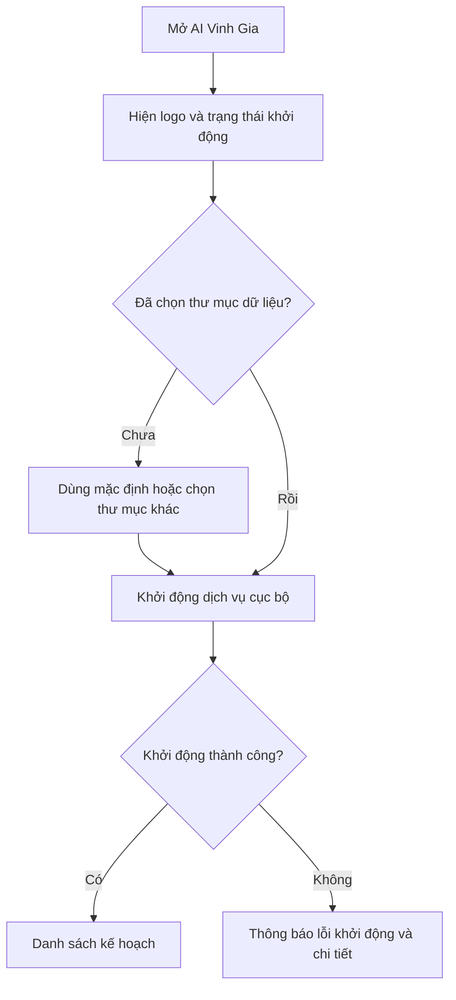
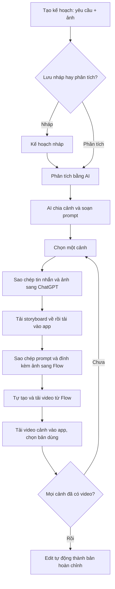
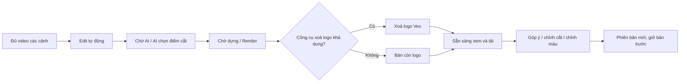
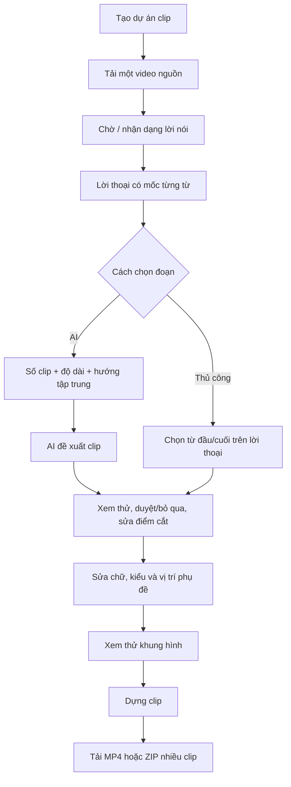
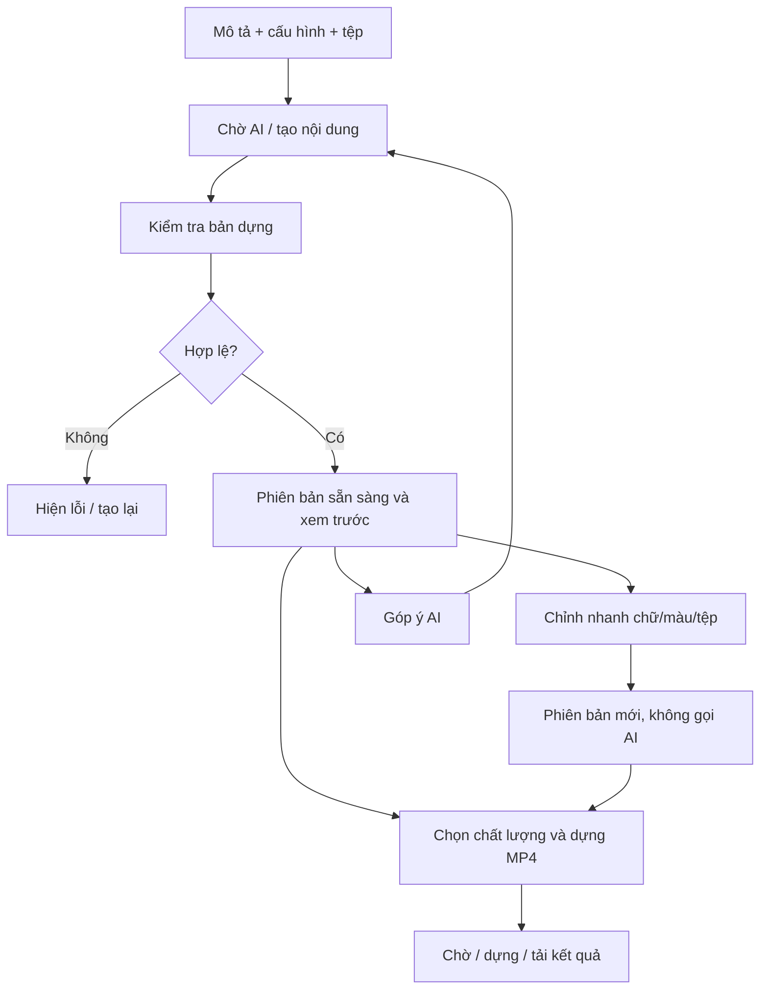

# AI Vinh Gia — Đặc tả chức năng và luồng sử dụng để thiết kế lại giao diện

**Ngày bàn giao:** 31/10/2026.  
**Đối tượng đọc:** thiết kế sản phẩm, UX/UI, người duyệt nghiệp vụ và lập trình viên triển khai giao diện.  
**Phạm vi:** ứng dụng desktop Windows hiện tại trong repository `autovideo-desktop`; có ghi chú riêng về chế độ LAN.  
**Căn cứ:** mã giao diện, API và nghiệp vụ tại thời điểm rà soát. Đây là mô tả hiện trạng để thiết kế, không phải xác nhận mọi chức năng đã được kiểm thử trực quan trên bản cài.

> Mục tiêu của đợt thiết kế là thay đổi cách trình bày và trải nghiệm thao tác, đồng thời giữ đúng dữ liệu, điều kiện thực hiện và luồng sản xuất. Các gợi ý bổ sung trong tài liệu được đánh dấu **Đề xuất thiết kế**, không mặc định là chức năng đã có.

## Mục lục

1. [Sản phẩm và người sử dụng](#1-sản-phẩm-và-người-sử-dụng)
2. [Bản đồ màn hình](#2-bản-đồ-màn-hình)
3. [Cài đặt, khởi động và khung ứng dụng](#3-cài-đặt-khởi-động-và-khung-ứng-dụng)
4. [Kế hoạch video theo cảnh](#4-kế-hoạch-video-theo-cảnh)
5. [Bản dựng hoàn chỉnh và hậu kỳ](#5-bản-dựng-hoàn-chỉnh-và-hậu-kỳ)
6. [Cắt clip từ video dài](#6-cắt-clip-từ-video-dài)
7. [Video HTML](#7-video-html)
8. [Công cụ xoá logo Veo](#8-công-cụ-xoá-logo-veo)
9. [Cài đặt ứng dụng](#9-cài-đặt-ứng-dụng)
10. [Trạng thái, hàng đợi và lỗi](#10-trạng-thái-hàng-đợi-và-lỗi)
11. [Dữ liệu, giới hạn và nguyên tắc bắt buộc](#11-dữ-liệu-giới-hạn-và-nguyên-tắc-bắt-buộc)
12. [Hiện trạng cần lưu ý khi thiết kế lại](#12-hiện-trạng-cần-lưu-ý-khi-thiết-kế-lại)
13. [Yêu cầu bàn giao của đội thiết kế](#13-yêu-cầu-bàn-giao-của-đội-thiết-kế)
14. [Kịch bản nghiệm thu UX](#14-kịch-bản-nghiệm-thu-ux)
15. [Nguồn đối chiếu](#15-nguồn-đối-chiếu)

## 1. Sản phẩm và người sử dụng

### 1.1 Sản phẩm giải quyết việc gì?

AI Vinh Gia hỗ trợ người làm nội dung sản xuất video quảng cáo/sản phẩm và video ngắn. Ứng dụng có bốn nhóm công việc độc lập:

| Nhóm | Đầu vào | App thực hiện | Kết quả |
|---|---|---|---|
| Kế hoạch video | Yêu cầu kịch bản, phong cách, ảnh tham chiếu | AI phân cảnh, soạn nội dung tạo ảnh và prompt video; quản lý ảnh/video từng cảnh | Kế hoạch, các cảnh có video được chọn |
| Bản hoàn chỉnh thuộc kế hoạch | Video được chọn của tất cả cảnh | AI chọn điểm cắt, ghép dựng, xoá logo nếu khả dụng; cho sửa điểm cắt và màu | MP4 có lịch sử phiên bản |
| Cắt clip | Một video dài có tiếng nói | Nhận dạng lời thoại, AI đề xuất đoạn hoặc chọn thủ công, sửa phụ đề, dựng clip | Nhiều clip ngắn và ZIP tải hàng loạt |
| Video HTML | Mô tả video, ảnh/video/nhạc, mẫu nếu có | AI tạo bố cục và chuyển động bằng HTML, xem trước, chỉnh nội dung, xuất MP4 | Các phiên bản nội dung và các lượt xuất video |
| Xoá logo Veo | Một hoặc nhiều video Veo | Xử lý xoá logo độc lập với dự án | Video sạch tải về |

**Phân biệt quan trọng:** trong luồng kế hoạch đang hiển thị, người dùng tự tạo ảnh trên ChatGPT và tự tạo video trên Google Flow ở trình duyệt bên ngoài. App chuẩn bị nội dung, quản lý đầu vào/kết quả và làm hậu kỳ. Không thiết kế nút làm người dùng hiểu rằng app đang tự động tạo video Veo ngay trong cửa sổ này.

### 1.2 Người dùng và quyền sử dụng

- Người dùng chính là nhân viên nội dung/marketing/sản xuất video, cần hướng dẫn bằng tiếng Việt và thao tác cụ thể.
- Bản desktop dùng trên một máy, không có màn hình đăng nhập hay hệ thống vai trò quản trị trong giao diện hiện tại.
- API key AI là cấu hình kết nối dịch vụ, không phải tài khoản đăng nhập ứng dụng.
- App và dữ liệu chạy trên máy Windows. Các tác vụ AI cần kết nối dịch vụ AI; tạo ảnh/video bên ngoài cần dịch vụ tương ứng.
- Chế độ LAN là khả năng triển khai bổ sung: nhiều trình duyệt có thể dùng planner qua mạng. Không suy diễn quyền của LAN thành mô hình tài khoản cho bản desktop.

### 1.3 Thuật ngữ để thống nhất trong thiết kế

| Thuật ngữ | Nghĩa trong sản phẩm |
|---|---|
| Kế hoạch | Một dự án video gồm yêu cầu, ảnh tham chiếu và danh sách cảnh |
| Cảnh, mã C1/C2… | Một đơn vị sản xuất trong kế hoạch; có prompt, storyboard và các bản video |
| Ảnh tham chiếu | Ảnh sản phẩm/nhân vật/bối cảnh giúp công cụ bên ngoài giữ đúng nhận diện |
| Storyboard / khung hình mở đầu | Ảnh tạo cho một cảnh, được tải lại vào app để dùng ở bước video |
| Prompt | Nội dung sao chép sang công cụ AI; cần giữ nguyên văn và thứ tự ảnh |
| Video đang dùng của cảnh | Một bản video được chọn để đưa vào bản hoàn chỉnh |
| Bản hoàn chỉnh | Video ghép từ các cảnh, có thể có nhiều phiên bản v1, v2… |
| Điểm cắt | Các khoảng thời gian được giữ từ video nguồn; EDL là dữ liệu kỹ thuật mô tả chúng |
| Lời thoại / transcript | Văn bản nhận dạng từ video, có mốc thời gian từng từ |
| Clip | Đoạn ngắn lấy từ video dài, khác với “cảnh” của kế hoạch |
| Phiên bản HTML | Một bản nội dung/chuyển động đã lưu; chưa đồng nghĩa đã có MP4 |
| Lượt dựng / render | Một lần xử lý để xuất file video từ dữ liệu hiện có |
| Ảnh mẫu màu / LUT | Tham chiếu màu hậu kỳ, khác với ảnh tham chiếu sản phẩm |

## 2. Bản đồ màn hình

### 2.1 Điều hướng hiện tại

```text
AI Vinh Gia
├── Kế hoạch video
│   ├── Danh sách kế hoạch
│   ├── Tạo kế hoạch
│   └── Chi tiết kế hoạch
│       ├── Cảnh → chọn cảnh → 3 bước sản xuất
│       ├── Bản hoàn chỉnh → dựng / xem / góp ý / chỉnh cắt / chỉnh màu / phiên bản
│       ├── Ảnh tham chiếu
│       └── Yêu cầu
├── Cắt clip
│   ├── Danh sách dự án + tạo dự án
│   └── Không gian cắt clip
│       ├── Video nguồn và lời thoại
│       ├── AI chọn đoạn / chọn thủ công
│       └── Duyệt, sửa phụ đề, xem thử và dựng
├── Video HTML [desktop]
│   ├── Danh sách + tạo dự án
│   └── Xem trước / nội dung nhanh / góp ý / phiên bản / tệp / dựng MP4
├── Xoá logo Veo
└── Cài đặt
```

### 2.2 Danh mục khung thiết kế

Mã dưới đây là mã bàn giao để trao đổi, không phải ID nội bộ của app.

| Mã | Màn hình/khung | Route hiện tại hoặc nơi mở |
|---|---|---|
| SYS-01 | Bộ cài và thông báo tải thành phần | Bộ cài Windows |
| SYS-02 | Khởi động, lỗi khởi động | Splash Tauri |
| SYS-03 | Chọn thư mục dữ liệu lần đầu | Hộp thoại Windows |
| APP-01 | Khung app, sidebar, thanh trạng thái | Dùng chung |
| PLAN-01 | Danh sách kế hoạch | `#/` |
| PLAN-02 | Tạo kế hoạch | `#/new` |
| PLAN-03 | Chi tiết kế hoạch và danh sách cảnh | `#/plan/:id` |
| PLAN-04 | Sửa yêu cầu/phân tích lại | Hộp thoại trong chi tiết |
| PLAN-05 | Chọn ảnh từ thư viện, xem ảnh lớn | Tạo kế hoạch / tab ảnh / từng cảnh |
| PLAN-06 | Bước 1: khung hình mở đầu | Trong cảnh |
| PLAN-07 | Bước 2: video Google Flow | Trong cảnh |
| PLAN-08 | Bước 3: tải và chọn video cảnh | Trong cảnh |
| FINAL-01 | Bản hoàn chỉnh, tiến trình, player, phiên bản | Tab Bản hoàn chỉnh |
| FINAL-02 | Trình chỉnh điểm cắt | Mở trong bản hoàn chỉnh |
| FINAL-03 | Góp ý AI và lịch sử góp ý | Trong bản hoàn chỉnh |
| FINAL-04 | Chỉnh màu, ảnh mẫu/LUT, so trước/sau | Trong bản hoàn chỉnh |
| CLIP-01 | Danh sách và tạo dự án cắt clip | `#/clips` |
| CLIP-02 | Video nguồn, nhận dạng, lời thoại | `#/clips/:id` |
| CLIP-03 | AI đề xuất clip | Hộp thoại trong workspace |
| CLIP-04 | Tạo clip/sửa điểm cắt thủ công | Thanh công cụ lời thoại |
| CLIP-05 | Chỉnh vị trí/kiểu phụ đề và dựng | Cột phải workspace |
| CLIP-06 | Sửa chữ phụ đề | Hộp thoại |
| CLIP-07 | Cài đặt/xoá dự án clip | Hộp thoại |
| HTML-01 | Danh sách và tạo Video HTML | `#/html` |
| HTML-02 | Chi tiết, xem trước, phiên bản | `#/html/:id` |
| HTML-03 | Chỉnh nội dung nhanh / góp ý AI | Trong chi tiết HTML |
| HTML-04 | Tệp dự án và lượt dựng MP4 | Trong chi tiết HTML |
| TOOL-01 | Xoá logo Veo, lịch sử, xem kết quả | `#/tools/remove-logo` |
| SET-01 | Cài đặt AI và tải thành phần | `#/settings` |
| COMMON-01 | Xác nhận xoá/hủy, lỗi, toast, trạng thái rỗng | Dùng chung |

## 3. Cài đặt, khởi động và khung ứng dụng

### 3.1 Cài đặt Windows

1. Người dùng chạy bộ cài AI Vinh Gia, chọn các lựa chọn cài đặt/shortcut.
2. Bộ cài kiểm tra WebView2, tải và cài thành phần này nếu máy chưa có.
3. Có lựa chọn tải model nhận dạng lời nói khoảng 73–74 MB.
4. Tải model có thể thất bại vì mạng hoặc máy chủ giới hạn lượt tải. App vẫn cài được; hướng dẫn tải lại ở **Cài đặt → Nhận dạng lời nói**.
5. Giao diện cần phân biệt “cài ứng dụng thành công” với “chưa tải xong thành phần tùy chọn”.

Logo Vinh Gia phải dùng thống nhất ở bộ cài, shortcut, splash, đầu ứng dụng và icon cửa sổ/taskbar. Việc đổi mã icon chỉ có hiệu lực ở bản `.exe` được build/cài mới.

### 3.2 Mở ứng dụng



- Lần đầu, thư mục dữ liệu mặc định là `D:\AutoVideo` nếu có ổ D; nếu không, dùng thư mục AutoVideo trong thư mục người dùng.
- Có thể chọn thư mục khác bằng hộp thoại Windows. Thư mục dữ liệu khác với thư mục cài ứng dụng.
- Khi đang khởi động cần hiển thị trạng thái chờ, tránh cảm giác app không phản hồi.
- Lỗi khởi động có màn riêng; hiện tại có chi tiết kỹ thuật để hỗ trợ chẩn đoán.
- Mở app lần thứ hai đưa cửa sổ đang có lên trước.
- Cửa sổ mặc định mở tối đa; kích thước cấu hình 1440×900, tối thiểu 1024×680.
- Đóng cửa sổ cuối hoặc chọn Thoát sẽ dừng dịch vụ/tiến trình con. App không có khay hệ thống để tiếp tục chạy nền sau khi đóng.
- **Phân biệt:** chuyển trang trong app có thể giữ tác vụ server đang chạy; đóng hẳn app có thể làm tác vụ bị gián đoạn.

### 3.3 Khung ứng dụng dùng chung

**Sidebar:** logo + tên AI Vinh Gia, các mục Kế hoạch video, Cắt clip, Video HTML, Xoá logo Veo; khu vực Gần đây và Cài đặt.

**Gần đây:** hiện tối đa ba kế hoạch/dự án clip mới cập nhật. Hiện chưa đưa dự án HTML vào danh sách này.

**Thanh nội dung:** tiêu đề, breadcrumb ở trang chi tiết, hành động chính, tab/bộ lọc theo ngữ cảnh.

**Thanh trạng thái cuối app:** trạng thái AI, khả dụng của công cụ xoá logo, số việc render đang chạy và đang chờ. Màu phải đi cùng chữ/icon.

**Menu Windows hiện có:** Mở thư mục dữ liệu; Mở thư mục log; Tải lại trang; Thoát. Đây là menu cửa sổ, chưa phải các nút trên trang Cài đặt.

**Tương tác chung:** thông báo ngắn khi thao tác thành công; lỗi tại vị trí liên quan; xem ảnh lớn; tải file. Link ChatGPT/Google Flow mở trình duyệt mặc định bên ngoài app.

## 4. Kế hoạch video theo cảnh

### 4.1 Luồng tổng quát



### 4.2 Danh sách kế hoạch — PLAN-01

**Mục đích:** tìm, mở và quản lý các kế hoạch.

- Ô tìm theo tên kế hoạch.
- Bộ lọc: Tất cả; Đang phân tích; Đã phân tích; Bản nháp; mỗi nhóm có số lượng.
- Kế hoạch phân tích lỗi đang được gom vào nhóm Bản nháp nhưng cần giữ nhãn lỗi rõ ràng.
- Danh sách sắp theo thời điểm cập nhật mới nhất.
- Mỗi dòng: tên, số cảnh, số ảnh tham chiếu, trạng thái, cập nhật gần nhất, Mở và menu thao tác.
- Hành động chính: **Tạo kế hoạch**.
- Xoá: có xác nhận; trên desktop là xoá vĩnh viễn. Nếu đang có việc ngăn xoá, nút phải giải thích lý do.
- Thiết kế đủ các trạng thái: đang tải; chưa có kế hoạch; không có kết quả tìm kiếm; không tải được danh sách; đang phân tích/chờ AI.

### 4.3 Tạo kế hoạch — PLAN-02

| Trường | Bắt buộc | Ý nghĩa/quy tắc |
|---|---|---|
| Tên kế hoạch | Có | Tối đa 200 ký tự |
| Yêu cầu kịch bản | Khi phân tích | Nội dung, thông điệp, sản phẩm, số cảnh/nhịp mong muốn |
| Phong cách giữ nhất quán | Không | Ánh sáng, bối cảnh, nhân vật, bảng màu… dùng xuyên các cảnh |
| Ảnh tham chiếu sản phẩm | Không bắt buộc trong form | Tối đa 12 ảnh/kế hoạch, mỗi ảnh cần nhãn |

Hai hành động:

- **Lưu nháp:** tạo kế hoạch và lưu ảnh, chưa gọi AI phân tích. Cho phép chưa có yêu cầu kịch bản.
- **Phân tích bằng AI:** tạo kế hoạch, tải ảnh, gửi phân tích rồi mở trang chi tiết.

Trong khi gửi, hiển thị đúng giai đoạn: tạo kế hoạch → thêm ảnh → gửi phân tích. Khi lỗi giữa chừng, form hiện tại tiếp tục từ bước đã làm, tránh tạo dự án trùng; không thiết kế nút “thử lại” như một yêu cầu tạo dự án mới.

**Ảnh tham chiếu:** tải từ máy bằng chọn file/kéo thả; hoặc chọn từ thư viện. Danh sách cho đổi nhãn, đổi thứ tự bằng kéo hoặc nút lên/xuống, bỏ ảnh trước khi gửi. Thứ tự này có ý nghĩa trong prompt. Dán ảnh có ở phần ảnh mẫu màu, chưa có trong uploader ảnh tham chiếu này.

**Thư viện ảnh:** chọn ảnh đã lưu, có tìm/lọc theo khả năng của picker; hiển thị ảnh, nhãn và nguồn dự án; báo ảnh đã có/đã chọn để tránh thêm trùng. Đây là picker trong luồng tạo, chưa có trang quản trị thư viện độc lập trong điều hướng chính.

### 4.4 Phân tích bằng AI và phân tích lại — PLAN-03/04

Kết quả AI tạo danh sách cảnh có mã, tiêu đề, nội dung tạo khung hình mở đầu, prompt Flow, ảnh đính kèm và cảnh báo/hướng dẫn.

- Đang xếp hàng: hiển thị vị trí nếu có, lý do chờ, AI chưa sẵn sàng/hàng đợi tạm dừng.
- Đang chạy: “AI đang phân tích kịch bản và viết prompt từng cảnh”. Không cần một phần trăm giả.
- Thành công: hiện workspace các cảnh.
- Thất bại: hiện lỗi và đường đi phân tích lại. Nếu có kết quả cũ, thông báo các cảnh đang thấy thuộc lần trước.
- **Phân tích lại:** mở hộp thoại sửa yêu cầu kịch bản và khóa nhất quán; không cho gửi yêu cầu trống hoặc gửi khi đang phân tích.
- Khi đổi yêu cầu/phân tích, dữ liệu prompt có thể thay đổi. Không hứa rằng storyboard/video cũ tự được cập nhật theo nội dung mới; đọc trạng thái từ hệ thống.

### 4.5 Trang chi tiết kế hoạch — PLAN-03

Đầu trang có tên, trạng thái/tỷ lệ cảnh có video, tải kế hoạch `.md`, tải ảnh tham chiếu `.zip`, Phân tích lại và Xoá khi được phép.

Bốn tab:

| Tab | Nội dung và thao tác |
|---|---|
| Cảnh | Danh sách cảnh bên cạnh, chọn cảnh, xem ba bước sản xuất |
| Bản hoàn chỉnh | Dựng và hậu kỳ; xem mục 5 |
| Ảnh tham chiếu | Xem lớn, tải từng ảnh hoặc ZIP tất cả |
| Yêu cầu | Xem/sao chép yêu cầu và khóa nhất quán; sửa qua hộp thoại phân tích lại |

Danh sách cảnh hiển thị mã/tiêu đề, thumbnail khi có, tiến độ khung hình/video. Có nút cảnh trước/sau, tổng số cảnh đã chọn video và lối sang Bản hoàn chỉnh.

Chuyển cảnh không được làm hủy lượt upload đang diễn ra. Cần giữ rõ cảnh đang chọn và bước đang thao tác.

### 4.6 Bước 1: khung hình mở đầu — PLAN-06

1. Đọc tin nhắn tạo ảnh do app chuẩn bị.
2. Xem danh sách ảnh phải đính kèm theo thứ tự, tải ảnh cần dùng.
3. Bấm **Sao chép tin nhắn**, **Mở ChatGPT**.
4. Thao tác tạo ảnh ở trình duyệt bên ngoài.
5. Tải ảnh về máy rồi **Chọn ảnh storyboard…** để tải vào cảnh.

Mỗi ảnh đính kèm cần có thứ tự, nhãn, cách prompt gọi ảnh, thumbnail/nút xem lớn, tải file và ghi chú. Ảnh chưa có phải hiện thiếu, không hiện như một tệp sẵn dùng.

Sau khi tải storyboard: hiện ảnh, tên file, thời gian; có **Đổi ảnh**. Nếu prompt đã thay đổi sau lúc tải ảnh, hiện cảnh báo “cần kiểm tra lại”; không đánh dấu ảnh là hoàn toàn hợp lệ chỉ vì file còn tồn tại.

Có giới hạn số lần upload storyboard/cảnh; khi hết lượt hoặc nghiệp vụ đang khóa, hiển thị nguyên nhân tại nút.

### 4.7 Bước 2: video trên Google Flow — PLAN-07

1. Sao chép prompt Flow.
2. Tải/chọn đúng các ảnh app chỉ định và đính kèm **đúng thứ tự**.
3. Mở Google Flow ở trình duyệt mặc định.
4. Đặt thông số theo hướng dẫn app.
5. Tự tạo video, kiểm tra chất lượng và tải file về máy.

Hiện prompt nguyên văn, cảnh báo, ảnh đính kèm, ghi chú và thông số: tỉ lệ, thời lượng, số video, độ phân giải, ước tính credit.

Thông số template hiện tại là **9:16, 10 giây, một video, 720p**. Đây đang là hướng dẫn từ hệ thống, chưa phải các lựa chọn tùy ý trên form. Credit hiển thị là ước tính cho thao tác ở Flow; không phải ví credit trong app.

Điểm cần nhấn: chỉ tải ảnh vào thư viện dự án Flow chưa đủ; phải đính kèm vào ô prompt theo hướng dẫn. Storyboard và các ảnh sản phẩm có vai trò/đánh số khác nhau, cần giữ ghi chú tương ứng.

### 4.8 Bước 3: tải và chọn video cảnh — PLAN-08

- Chọn file hoặc kéo MP4/MOV vào vùng tải. Hiển thị định dạng, thời lượng và dung lượng cho phép trước khi người dùng chọn.
- Có phần trăm/byte tải lên, tên file và **Hủy tải lên**.
- Upload đạt 100% vẫn còn bước “Đang kiểm tra video”; không hiển thị hoàn tất trước khi server xác nhận.
- Tải thành công: video mới **tự trở thành bản đang dùng** của cảnh.
- Danh sách các bản: player, số bản, tên file, thời lượng, kích thước hình, dung lượng, thời gian, cảnh báo không có âm thanh nếu có.
- Có **Chọn lại bản này** cho bản cũ. Mỗi cảnh chỉ có một video được chọn.
- Chọn video khác có thể khiến bản hoàn chỉnh trước đó thành “Cũ vì đổi video”.
- Giới hạn hiện tại: tối đa 5 video/cảnh; mỗi video 1–60 giây; dung lượng theo cấu hình trả về.
- Rời hẳn trang có thể hủy upload đang truyền; đổi cảnh trong workspace được giữ lượt upload. Phải phân biệt hai hành vi.

## 5. Bản dựng hoàn chỉnh và hậu kỳ

### 5.1 Điều kiện và luồng dựng — FINAL-01

Điều kiện cốt lõi: mọi cảnh cần có video đang dùng. Dùng thông báo khóa do server trả để giải thích các điều kiện khác như đang có tác vụ hoạt động.



Khi dựng cần thể hiện: phiên bản đang xử lý, bước hiện tại, vị trí hàng đợi, tiến độ nếu có, số việc đang chạy/tối đa và nút Hủy bản dựng.

Nếu công cụ xoá logo tắt, vẫn có thể dựng; phải ghi rõ kết quả còn logo. Không dùng nhãn “video sạch” cho kết quả này.

### 5.2 Xem kết quả và phiên bản

- Player có điều khiển và mốc bắt đầu các cảnh.
- Tên phiên bản, tổng thời lượng, trạng thái đã/chưa xoá logo, thông tin chỉnh màu.
- **Tải video** MP4; trong trường hợp phù hợp có tải bản gốc còn logo.
- Tóm tắt AI, ghi chú và nguồn tạo phiên bản: AI, sửa điểm cắt, góp ý hoặc chỉnh màu thủ công.
- Timeline theo cảnh: đoạn giữ và đoạn bỏ có cách thể hiện khác nhau; bấm để tua tới vị trí liên quan; có lý do cắt.
- Có lưới khung hình để kiểm tra nhanh nếu đã được tạo.
- Danh sách phiên bản: số v, thời điểm, thời lượng, trạng thái, nhãn cũ vì đổi video.
- Chọn bản cũ để xem không có nghĩa ghi đè bản mới hay đổi video nguồn của cảnh.
- **Edit lại tự động** tạo một bản dựng mới. Các bản trước được giữ.

### 5.3 Chỉnh điểm cắt — FINAL-02

Đây là trình sửa khoảng thời gian giữ từ từng cảnh, không phải timeline dựng phim đa track đầy đủ.

- Xem video nguồn của từng cảnh.
- Chỉnh `in/out` bằng số giây hoặc lấy vị trí đang phát.
- Giữ nhiều đoạn trong một cảnh; chia đoạn, thêm đoạn và xoá đoạn theo khả năng trình chỉnh.
- Mỗi cảnh phải còn ít nhất một đoạn; khoảng thời gian phải hợp lệ và nằm trong video nguồn.
- Hiện tổng thời lượng dự kiến, so với bản đang xem.
- Ghi chú thay đổi, tối đa 300 ký tự.
- Render thành phiên bản mới; đánh dấu lỗi đúng cảnh/đoạn nếu server từ chối.
- Khi AI chưa tạo xong điểm cắt, trình chỉnh phải giải thích vì sao chưa dùng được.

### 5.4 Góp ý cho AI — FINAL-03

- Người dùng góp ý trên **phiên bản đang xem**. Bản cha được giữ nguyên.
- Ví dụ: “Cảnh C4 kết hơi nhanh, giữ hộp sản phẩm thêm một giây”, “Cảnh 3 tối quá”, “Màu ấm hơn, giữ nguyên điểm cắt”.
- Tối đa 1.000 ký tự; gửi bằng nút hoặc Ctrl+Enter.
- Các chip gợi ý có sẵn: màu ấm hơn, tương phản cao hơn, sáng hơn, màu tươi hơn, màu nhạt/điện ảnh hơn, giữ nguyên điểm cắt.
- AI có thể sửa điểm cắt và/hoặc màu. Lịch sử cần cho biết thay đổi loại nào và bắt nguồn từ bản v nào.
- Nếu chỉ đổi màu, hệ thống có thể bỏ qua dựng và xoá logo lại, xử lý trên bản sạch đang có.
- Lịch sử góp ý cho phép mở bản tương ứng, tải kết quả, góp ý tiếp và thử lại bước chỉnh màu khi có hành động này.

Không gộp thao tác góp ý AI với “chỉnh màu bằng tay”: một thao tác gọi AI, thao tác kia không cần AI.

### 5.5 Chỉnh màu bằng tay — FINAL-04

| Điều khiển | Khoảng hiện tại | Trung tính |
|---|---|---|
| Nhiệt độ màu | 4000–9000 K | 6500 K |
| Tương phản | 0,70–1,50 | 1,00 |
| Độ sáng | −0,25 đến +0,25 | 0 |
| Bão hoà | 0,50–1,80 | 1,00 |
| Sống động | −0,50 đến +1,00 | 0 |
| Gamma | 0,70–1,40 | 1,00 |

- Thanh trượt, giá trị số và hướng dẫn ý nghĩa; nút Mặc định. Nhấp đúp thanh trượt trả thông số đó về trung tính.
- **Xem trước:** tạo ảnh trước/sau tại ba mốc thời gian. Đây là ảnh kiểm tra, không phải video preview cập nhật liên tục.
- Nếu đã đổi thông số sau khi xem trước, báo ảnh trước/sau đang cũ và yêu cầu xem trước lại.
- **Tạo phiên bản:** chỉ chạy chỉnh màu, giữ bản hiện tại. Nếu chưa thay đổi, vô hiệu hoá và giải thích.
- Màu được áp từ bản sạch chưa chỉnh màu, tránh chồng chỉnh màu qua nhiều phiên bản.
- Chỉnh riêng từng cảnh có thể được AI tạo qua góp ý; panel hiện các thiết lập đó và cho bỏ. Chưa có đầy đủ bộ slider riêng từng cảnh.

**Theo ảnh mẫu:** tải/chọn/kéo thả/dán ảnh PNG/JPG/WebP; chọn từ ảnh tham chiếu/storyboard có sẵn; hiển thị ảnh đang dùng, cường độ, chọn chỉ tông màu hoặc cả độ sáng, tùy chọn khớp riêng từng cảnh. Có thể bỏ ảnh mẫu.

**Theo LUT:** tải/chọn file `.cube`, điều chỉnh cường độ. Đây là chế độ khác với khớp ảnh.

Khớp ảnh/LUT chạy trước các slider và không gọi AI. Tệp đang được phiên bản sử dụng có thể không được xoá; UI phải phản ánh điều kiện đó.

### 5.6 Hủy, lỗi và làm lại

| Bước bị lỗi/hủy | Thông tin cần giữ | Hành động phục hồi |
|---|---|---|
| AI chọn điểm cắt | Lỗi AI, phiên bản liên quan | Edit lại tự động theo hành động có sẵn |
| Render | Thông tin lỗi và điểm cắt nếu đã có | Chỉnh điểm cắt/render lại hoặc dựng lại |
| Xoá logo | Bản render còn logo | Thử xoá logo lại; có thể tải bản còn logo khi được cung cấp |
| Chỉnh màu | Bản sạch chưa chỉnh màu | Thử chỉnh màu lại ở lịch sử phiên bản |
| Video nguồn đã thay đổi | Bản cũ vẫn xem được, nhãn outdated | Edit lại tự động để dùng lựa chọn video mới |

Hộp thoại hủy phải nêu bước sẽ dừng và phần kết quả còn giữ. Không yêu cầu người dùng dựng lại toàn bộ khi hệ thống đã có bước phục hồi riêng.

## 6. Cắt clip từ video dài

### 6.1 Luồng tổng quát



### 6.2 Danh sách và tạo dự án — CLIP-01

- Danh sách: tên dự án, trạng thái video nguồn, thông tin/số clip, cập nhật, mở và xoá.
- Form tạo: tên dự án tối đa 200 ký tự; thuật ngữ/tên riêng tùy chọn tối đa 500 ký tự, ngăn bằng dấu phẩy.
- Thuật ngữ nhằm hỗ trợ nhận dạng tên sản phẩm, thương hiệu, tên người.
- Thành công mở workspace dự án. Chưa có video thì hiển thị vùng tải nguồn.
- Do dùng lại thành phần LAN, form hiện tại còn có thể hiện ô “Tên của bạn”; xem các điểm cần chuẩn hóa ở mục 12.

### 6.3 Tải video nguồn và nhận dạng — CLIP-02

- Một video nguồn cho một dự án cắt clip.
- Nhận MP4, MOV, MKV hoặc WebM có tiếng nói; không dùng giới hạn của video cảnh để áp vào video nguồn dài.
- Có kéo thả/chọn file, tiến độ tải, hủy tải, kiểm tra file/thời lượng và dung lượng đĩa.
- Tải thành công sẽ vào luồng nhận dạng. Nếu chưa cài model nhận dạng, hướng người dùng sang Cài đặt và cho thấy lý do chức năng chưa sẵn sàng.
- Nhận dạng có trạng thái chờ tới lượt, đang chạy, thành công, lỗi, đã hủy. Tiến độ xử lý có thể là ước tính theo thời lượng, phải ghi rõ khi không có phần trăm thật.
- Nhận dạng chạy cục bộ bằng CPU khi dùng provider mặc định của desktop; tải model cần mạng một lần. Bước AI chọn đoạn vẫn là một dịch vụ khác.
- Trong khi chờ/chạy có thể rời trang trong app; không đồng nghĩa có thể tắt hẳn app.
- Khi lỗi/hủy, video nguồn còn được giữ để nhận dạng lại nếu được phép.
- Khi đã có clip, không nhận dạng lại trên cùng dự án vì điểm cắt phụ thuộc mốc từ của transcript. Muốn làm lại cần dự án mới theo hướng dẫn hiện tại.

### 6.4 Không gian làm việc clip

Hiện tại chia ba vùng chính:

| Vùng | Nội dung |
|---|---|
| Trái | Danh sách clip: mã, tiêu đề, đầu/cuối, độ dài, trạng thái; chọn một clip để thao tác |
| Giữa | Player video nguồn, tổng quan vị trí các clip, thao tác clip, transcript và công cụ chọn đoạn |
| Phải | Khung xem trước 9:16, hộp phụ đề có thể kéo, kiểu phụ đề, xem thử khung hình, dựng/hủy |

Đầu trang: tên dự án, trạng thái nhận dạng, AI chọn thêm đoạn, Tạo clip từ đoạn đang chọn, tải tất cả ZIP, Cài đặt dự án.

Chọn clip phải đồng bộ: clip đang sáng trong danh sách → video tua tới đầu clip → lời thoại cuộn tới đoạn tương ứng → phụ đề hiện đúng clip. Không để người dùng sửa phụ đề của clip A trong khi player/tiêu đề đang ở clip B.

### 6.5 Lời thoại và chọn đoạn thủ công — CLIP-04

- Hiện lời thoại theo câu/từ và mốc thời gian; đánh dấu từ đang phát, đoạn clip đang chọn và vùng đang soạn.
- Tìm trong lời thoại không cần gõ dấu; có số kết quả và chuyển trước/sau.
- Bấm câu/từ để tua video khi ở chế độ xem.
- Tạo clip thủ công: chọn từ đầu, từ cuối hoặc kéo chuột qua vùng từ.
- Chỉnh điểm cắt clip: chọn lại từ, nhích theo câu, sửa tiêu đề tùy chọn tối đa 120 ký tự.
- Hiển thị đầu/cuối và tổng thời lượng; phát thử trước khi lưu; nút Lưu/Tạo và Hủy soạn.
- Clip thủ công phải dài 3–300 giây; không cho lưu đoạn ngoài phạm vi hoặc chưa có đủ hai đầu.
- Ranh giới dựa trên từ của transcript, không phải kéo tự do từng frame như phần mềm dựng phim.

### 6.6 AI đề xuất clip — CLIP-03

| Tham số | Giá trị hiện tại |
|---|---|
| Số clip mong muốn | 1–15; mặc định 5 |
| Độ dài mỗi clip | 15–30; 30–60; 60–90; 90–180 giây |
| Muốn tập trung vào… | Không bắt buộc; tối đa 300 ký tự |
| Loại trừ đoạn đã có | Có khi dự án đã có clip; dùng để gợi ý thêm đoạn mới |

AI đọc lời thoại, tìm đoạn có thể đứng độc lập và kiểm tra lại. Chỉ tạo đề xuất, chưa xuất video.

Cần thiết kế các tình huống: chưa có nguồn; nhận dạng chưa xong; đang xếp hàng/chạy; AI lỗi; không tìm được đoạn phù hợp; đề xuất được một số clip; gợi ý thêm. Số clip yêu cầu là mục tiêu, không hứa luôn trả đủ số lượng.

Không tìm được đoạn là một kết quả nghiệp vụ hợp lệ, cần gợi ý đổi độ dài/hướng tập trung hoặc chọn thủ công. Không hiển thị như lỗi hệ thống bắt buộc thử lại.

### 6.7 Duyệt và quản lý một clip

- Phát riêng khoảng của clip.
- **Duyệt** clip đề xuất.
- **Bỏ qua** clip không dùng; có **Khôi phục** về đề xuất.
- **Sửa điểm cắt** và tiêu đề.
- **Sửa chữ phụ đề**.
- **Dựng/Dựng lại**, xem tiến độ, hủy lượt đang dựng.
- **Tải MP4** khi đã sẵn sàng; tải ZIP các clip đã dựng qua nút đầu trang.

Nhãn cần phân biệt: chờ duyệt, đã duyệt, bỏ qua, đang dựng, dựng lỗi, đã dựng vN, cần dựng lại do phụ đề đổi. Bản đề xuất và bản file MP4 là hai đối tượng khác nhau.

Hiện nút dựng và server có thể nhận yêu cầu khi clip còn đề xuất; clip bị bỏ qua thì không được dựng. Không giả định người dùng luôn phải bấm một màn duyệt riêng trước khi có thể dựng, cũng không coi việc dựng là tự đổi trạng thái clip sang đã duyệt.

### 6.8 Chỉnh phụ đề — CLIP-05/06

**Kiểu hiển thị:** Tô từng từ, Karaoke, Tối giản, Không phụ đề. Font thực tế do trạng thái dịch vụ cung cấp, mặc định Arial có hỗ trợ tiếng Việt.

**Bố cục:** hộp phụ đề trên khung xem trước có thể kéo vị trí và chỉnh bề rộng bằng mép trái/phải. Thay đổi hiển thị tức thì, được lưu khi kết thúc thao tác. Khi dựng/xem thử phải dùng giá trị mới nhất.

**Xem thử khung hình:** dựng một khung để kiểm tra kết quả phụ đề thực tế; khác với hộp chữ minh hoạ trên giao diện. Nếu bộ phụ đề không khả dụng, hiện lý do và giữ lựa chọn không phụ đề.

**Sửa chữ:** mỗi từ có ô nhập; sửa chữ nhưng giữ mốc thời gian. Để trống ô là ẩn từ, không xoá mốc từ khỏi transcript. Có thể ghép cách viết đúng vào ô đầu và ẩn các ô thừa của một tên sản phẩm bị tách sai.

Hộp thoại có số từ/số từ ẩn, mốc thời gian, bản nhận dạng gốc để đối chiếu; các nút **Về bản nhận dạng**, **Đóng**, **Lưu**, **Lưu và dựng lại**.

Lưu chữ/vị trí/kiểu không tự thay nội dung file MP4 cũ. Khi bản đã xuất không còn khớp, cần nhãn “cần dựng lại”; bản trước vẫn giữ.

### 6.9 Cài đặt dự án clip — CLIP-07

- Đổi tên, sửa thuật ngữ và lưu.
- Thuật ngữ thay đổi chỉ có tác dụng khi nhận dạng tiếp theo, không sửa transcript đang có.
- Chỉ đề xuất nhận dạng lại khi trạng thái và dữ liệu cho phép, đặc biệt chưa có clip và video nguồn còn tồn tại.
- Xoá trên desktop là xoá vĩnh viễn cả nguồn, lời thoại, clip và các bản xuất; có xác nhận và chặn khi đang bận.

## 7. Video HTML

### 7.1 Mục đích và sự khác biệt

Tạo video đồ hoạ/chữ/chuyển động từ mô tả và tệp người dùng bằng AI, xem trước ngay trong app, sau đó xuất MP4. Đây là luồng độc lập, không phải bước thứ tư của Google Flow và không cần người dùng biết lập trình HTML.

Phải phân biệt hai mốc:

- **Phiên bản nội dung sẵn sàng:** đã tạo/kiểm tra và xem trước được.
- **Lượt dựng MP4 sẵn sàng:** đã xuất thành file video để tải.

### 7.2 Tạo dự án — HTML-01

| Trường | Nội dung |
|---|---|
| Tên dự án | Bắt buộc, tối đa 200 ký tự |
| Mô tả video | Bắt buộc khi tạo bằng AI, tối đa 10.000 ký tự |
| Mẫu | Tự chọn hoặc mẫu có sẵn; chỉ hiện mẫu tương thích với tỉ lệ |
| Tỉ lệ | 9:16, 1:1, 16:9 |
| Thời lượng | 1–60 giây; mặc định 15 |
| Chất lượng mặc định | 720p hoặc 1080p |
| Ảnh/video/nhạc | Không bắt buộc; chọn nhiều tệp |
| Nâng cao | Model tạo nội dung và model kiểm tra bằng hình; mặc định tự chọn phù hợp |

Luồng gửi: tạo dự án → tải lần lượt từng tệp với tiến độ và lỗi riêng → gửi yêu cầu AI → mở chi tiết. Nếu bước giữa lỗi, tiếp tục trên dự án đã tạo và những tệp chưa tải, tránh tạo trùng.

Danh sách dự án có tên, tỉ lệ/thời lượng, trạng thái/số phiên bản mới nhất, thời gian, mở và xoá vĩnh viễn. Chưa có chức năng tìm/lọc tương đương trang kế hoạch trong giao diện hiện tại.

### 7.3 Luồng tạo và chỉnh nội dung



### 7.4 Chi tiết và xem trước — HTML-02

- Đầu trang: tên, tỉ lệ, kích thước hình, thời lượng, 30 fps, mẫu.
- Vùng phiên bản đang chọn: trạng thái chờ/tạo/kiểm tra/lỗi/hủy hoặc player xem trước.
- Xem trước có play/seek theo player; có Tải lại xem trước nếu cần.
- Nếu phiên bản lỗi, hiện lý do, lỗi kiểm tra và đường tạo lại. Bản sẵn sàng có thể vẫn kèm cảnh báo kiểm tra.
- Lịch sử: vN, AI/Bạn tạo, trạng thái, thời điểm, tóm tắt/prompt/góp ý, model nếu có.
- Chọn bản cũ để xem/chỉnh từ bản đó; giữ rõ phiên bản cha.
- Đang tạo có thể hủy theo hành động hiện có và có thể rời trang trong app.

### 7.5 Chỉnh nhanh và góp ý — HTML-03

**Chỉnh nội dung nhanh:** chỉ hiện khi phiên bản có khai báo các biến chỉnh sửa. Có trường chữ, bộ chọn màu và chọn tệp asset. Lưu tạo phiên bản mới, không gọi AI; có Hoàn tác bản nháp chưa lưu. Không hứa mọi phần tử trong preview đều kéo/chỉnh trực tiếp được.

**Góp ý để AI sửa:** nhập tối đa 5.000 ký tự; AI tạo phiên bản mới từ bản đang xem, giữ bản cha. Ví dụ đổi cỡ tiêu đề, màu nền, bố cục. Không đảm bảo mọi yêu cầu thời lượng/cấu hình đều được hỗ trợ chỉ vì có thể gõ vào ô góp ý.

### 7.6 Tệp và xuất MP4 — HTML-04

**Tệp dự án:** tên, loại, dung lượng, thumbnail ảnh; thêm nhiều tệp, tiến độ và lỗi, xoá khi được phép. Tệp thêm sau được dùng ở lần AI tạo/sửa tiếp theo; không tự chèn vào phiên bản cũ.

**Dựng MP4:** chọn phiên bản sẵn sàng và chất lượng 720p/1080p. Khi thiếu bộ dựng, hướng sang Cài đặt; xem trước vẫn có thể sử dụng.

Mỗi lượt dựng có phiên bản nguồn, chất lượng, trạng thái, hàng đợi, tiến độ, thời điểm, ảnh bìa, dung lượng/thời lượng khi xong. Hành động: hủy lượt đang chờ/chạy; thử lại khi lỗi/hủy; xem, tải về và mở thư mục khi sẵn sàng.

Chặn gửi trùng lượt đang hoạt động cho cùng phiên bản/chất lượng. Trường hợp mạng trả kết quả chưa rõ phải kiểm tra lượt đã có, tránh tạo bản dựng lặp chỉ vì bấm Thử lại.

## 8. Công cụ xoá logo Veo

### 8.1 Mục đích và thao tác — TOOL-01

Dùng độc lập: không cần tạo kế hoạch, cảnh hay dự án clip.

1. Chọn hoặc kéo một/nhiều MP4/MOV vào vùng tải.
2. App tải lần lượt; file nào tải/kiểm tra xong vào hàng đợi xử lý ngay.
3. Theo dõi từng việc đang chờ/đang xoá.
4. Xem kết quả sạch và tải về.

### 8.2 Thành phần cần thiết kế

- Vùng nhận nhiều video; giới hạn file/thời lượng; lý do công cụ chưa khả dụng.
- Tiến độ upload hiện tại, số video còn lại, Hủy tải lên; lỗi riêng từng file.
- Hủy upload không đồng nghĩa hủy các việc đã tải xong trước đó. Các việc đó cần nút Hủy riêng trong danh sách.
- Bảng việc: tên, kích thước/dung lượng, thời lượng, trạng thái/tiến độ, thời gian, thao tác.
- Trạng thái: đang chờ, đang xoá, xong, lỗi, đã hủy, hết hạn.
- Đang chờ có vị trí; đang xử lý có phần trăm khi công cụ báo được.
- Có Thử lại khi server cho phép; không mặc định mọi việc lỗi/hết hạn đều còn đủ nguồn để làm lại.
- Xem kết quả bằng player và Tải về; đóng được khung xem trước.
- Chỉ báo tổng số việc chạy/chờ và sức chứa đồng thời của hàng đợi.
- Kết quả công cụ có hạn lưu, hiện mặc định 7 ngày; danh sách hiện lấy tối đa 30 việc gần nhất theo định danh trình duyệt.

Luồng xoá logo gắn với bản hoàn chỉnh có hành động và dữ liệu phục hồi riêng; không cần buộc người dùng tải lại MP4 đó vào công cụ độc lập.

## 9. Cài đặt ứng dụng

### 9.1 AI

- Hiện máy chủ AI, model hiện tại, key đã lưu/chưa có, trạng thái kết nối và hàng đợi.
- Nhập key bằng trường mật khẩu. Key cũ chỉ hiện dấu hiệu đã lưu và bốn ký tự cuối; không đọc lại toàn bộ.
- **Kiểm tra** lấy danh sách model và kiểm tra khả năng kết nối với key mới hoặc key đã lưu.
- Chọn model, sau đó **Lưu**; đổi key thì phải kiểm tra lại.
- Để trống key mới là giữ key cũ, vẫn có thể đổi model sau kiểm tra.
- Hiện riêng đang kiểm tra, lỗi kiểm tra, đang lưu, đã lưu.
- Địa chỉ máy chủ và trạng thái hàng đợi hiện là thông tin đọc, không có công tắc điều khiển server/worker tại đây.

### 9.2 Nhận dạng lời nói

- Hiện provider, CPU/số luồng, model, dung lượng, trạng thái đã cài/chưa có.
- Tải model một lần; có tiến độ, Hủy tải, Tải lại và lỗi có hướng dẫn.
- Khi máy chủ tải model trả 429, thông báo đây là giới hạn tải tạm thời, không biến thành “ứng dụng cài thất bại”. Mã nguồn hiện có cơ chế chờ/thử lại có giới hạn.
- Tải xong làm mới trạng thái cắt clip.
- Khi dùng dịch vụ STT riêng theo cấu hình, chỉ hiện thông tin phù hợp, không ép người dùng tải model local.
- Số luồng CPU hiện là thông tin hiển thị, chưa có ô điều chỉnh trong giao diện.

### 9.3 Bộ dựng Video HTML

- Hiện đã cài/chưa cài/đang tải, dung lượng tải và dung lượng trên đĩa; vị trí khi đã cài.
- Tải khi người dùng bấm, không tự tải chỉ vì mở trang HTML.
- Có tiến độ, hủy và thử lại. Thiếu bộ dựng chỉ chặn xuất MP4, không mặc định chặn xem trước.
- Màn HTML có thể mở Cài đặt và tập trung đúng mục bộ dựng.

### 9.4 Xoá logo, hàng đợi và giao diện

| Mục | Nội dung hiện tại | Có chỉnh trực tiếp? |
|---|---|---|
| Xoá logo Veo | Đang bật/tắt, lý do, giới hạn thời lượng, hạn lưu | Không; trạng thái đọc |
| Hàng đợi dựng | Đang chạy/tối đa, số chờ | Không; chưa có nút đổi mức song song |
| Giao diện | Tối, Sáng, Theo Windows | Có |

Không thiết kế các dòng đọc thành công tắc/cấu hình lưu được nếu chưa được duyệt mở rộng chức năng.

## 10. Trạng thái, hàng đợi và lỗi

### 10.1 Bộ trạng thái dùng chung

| Nhóm | Trạng thái phải có | Cách trình bày cần giữ |
|---|---|---|
| Tải dữ liệu màn hình | Loading / thành công / rỗng / lỗi | Skeleton, lời giải thích rỗng, Thử lại khi lỗi |
| Biểu mẫu | Chưa hợp lệ / hợp lệ / gửi / lỗi / xong | Lỗi gần trường, khóa nút có lý do, không gửi lặp |
| Upload | Chọn / tải / kiểm tra / xong / hủy / lỗi | 100% truyền file chưa phải hoàn tất xử lý |
| AI | Chờ / chạy / xong / lỗi / hủy | Phân biệt chờ hàng và thực sự đang làm |
| Render | Chờ / chạy từng giai đoạn / xong / lỗi / hủy | Tiến độ thuộc bước nào, hành động phục hồi tương ứng |
| Tải thành phần | Chưa có / tải / chờ thử lại / xong / lỗi / hủy | Hướng dẫn tiếp tục chức năng bị phụ thuộc |
| Kết quả cũ | Còn xem được nhưng không khớp dữ liệu mới | Nhãn rõ và nút tạo bản mới |

### 10.2 Hàng đợi

- Hàng đợi AI và hàng đợi render là hai loại riêng; không dùng cùng một con số gây hiểu lầm.
- Hàng đợi render phục vụ nhiều loại việc; mặc định tối đa 2 việc cùng lúc, cấu hình có thể khác.
- Luôn dùng dữ liệu số đang chạy, số chờ, mức song song và vị trí của chính việc đang xem.
- Có thể nhiều việc cùng ở trạng thái đang chạy; hủy một việc không có nghĩa hủy toàn bộ hàng đợi.
- Nếu triển khai có cả công việc app và LAN, công việc app được ưu tiên trong số việc đang chờ; không ngắt công việc đã chạy.
- Bản desktop không hiển thị hạn mức lượt/giờ theo người dùng như LAN; không hiểu điều này là AI bên ngoài không có giới hạn sử dụng.

### 10.3 Bảng tình huống lỗi và đường tiếp tục

| Tình huống | Thông tin/hành động nên có |
|---|---|
| Chưa có API key | Mở Cài đặt AI; giữ bản nháp/đầu vào đã nhập |
| AI chưa sẵn sàng/hàng đợi dừng | Việc đang chờ, lý do chờ; không hiện tiến độ giả |
| Mất kết nối dịch vụ cục bộ | Lỗi tải dữ liệu, thử lại; phân biệt với AI đang chờ |
| Model tải lỗi 429/mạng | Tải lại sau/chờ tự thử lại; app vẫn dùng được các phần không phụ thuộc |
| Video/ảnh không đúng định dạng, quá lớn, hỏng | Tên file và điều kiện bị vi phạm; chọn file khác |
| Thiếu dung lượng đĩa | Cần dọn/thêm dung lượng; không khuyến khích bấm upload/render liên tục |
| Không có hoặc ít lời nói | Cảnh báo AI chọn đoạn dựa lời thoại có thể không hiệu quả |
| AI không tìm thấy clip tốt | Kết quả rỗng hợp lệ; đổi yêu cầu hoặc chọn thủ công |
| Chỉnh điểm cắt không hợp lệ | Đánh dấu cảnh/đoạn và giá trị cần sửa |
| Xoá logo lỗi | Giữ bản raw, thử lại bước xoá logo khi được phép |
| Chỉnh màu lỗi | Giữ bản sạch, thử lại bước chỉnh màu |
| Thiếu bộ dựng HTML | Link Cài đặt đúng mục, vẫn cho xem trước nếu sẵn sàng |
| Tệp bị dùng/đang có việc nên chưa xoá được | Thông báo lý do và thử lại sau; không âm thầm xoá một phần |
| App khởi động lại khi có việc đang xử lý | Đọc trạng thái phục hồi/lỗi mới; không tiếp tục hiển thị spinner cũ vô thời hạn |
| Không rõ yêu cầu trước đã gửi thành công chưa | Làm mới/đối chiếu trạng thái, tránh tạo tác vụ trùng |

### 10.4 Hành vi khi rời trang/đóng app

- Các việc đã được server tiếp nhận thường tiếp tục khi chuyển màn hình trong app.
- Upload còn đang truyền có thể bị hủy khi thành phần/trang bị đóng; không hứa chạy nền sau khi rời trang.
- Tắt app dừng dịch vụ và tiến trình con. Khi mở lại, một số việc được xếp lại hoặc đánh dấu lỗi để thử lại theo loại việc.
- **Đề xuất thiết kế:** cân nhắc thông báo rời trang/đóng app khi có upload hoặc xử lý hoạt động. Đây là bổ sung UX cần thống nhất khi triển khai, không phải cam kết hộp thoại hiện đã có.

## 11. Dữ liệu, giới hạn và nguyên tắc bắt buộc

### 11.1 Quan hệ dữ liệu để thiết kế đúng ngữ cảnh

```text
Kế hoạch → nhiều cảnh → nhiều storyboard đã tải / nhiều video → một video đang dùng mỗi cảnh
Kế hoạch → nhiều bản hoàn chỉnh → phiên bản cha/con + điểm cắt + màu + file kết quả
Dự án cắt clip → một nguồn → transcript → nhiều clip → nhiều lượt dựng/phiên bản MP4
Dự án HTML → nhiều tệp → nhiều phiên bản nội dung → nhiều lượt dựng MP4
Công cụ xoá logo → nhiều việc độc lập → input/output và hạn lưu
```

### 11.2 Giới hạn ảnh hưởng UI

Các số là mặc định/giới hạn hiện trạng, cần ưu tiên dữ liệu server trả về và cấu hình thực tế khi triển khai.

| Đối tượng | Định dạng/giới hạn |
|---|---|
| Ảnh tham chiếu/storyboard | PNG/JPG/WebP, khoảng 10 MiB/ảnh theo kiểm tra giao diện |
| Ảnh tham chiếu một kế hoạch | Tối đa 12 |
| Upload storyboard | Tối đa 8 lần/cảnh |
| Ảnh dùng trong một prompt Flow | Theo danh sách app tạo; quy tắc sản xuất tối đa 3 ảnh tham chiếu, storyboard có hướng dẫn riêng |
| Video cảnh | MP4/MOV, 1–60 giây, tối đa 5 bản/cảnh; dung lượng từ API |
| Video nguồn clip desktop | Server mặc định 4 GiB, 3 giờ; UI hiện còn khác biệt cần chuẩn hóa, xem mục 12 |
| Video nguồn clip LAN | Mặc định 2 GiB, 3 giờ |
| Clip chọn thủ công | 3–300 giây |
| Số clip AI yêu cầu | 1–15 |
| Ảnh mẫu màu | PNG/JPG/WebP, 15 MiB |
| LUT | `.cube`, 5 MiB |
| Góp ý AI bản hoàn chỉnh | 1.000 ký tự |
| Video HTML | 1–60 giây; 9:16 / 1:1 / 16:9; 720p / 1080p; 30 fps |
| Tệp HTML ảnh | PNG/JPG/WebP/GIF, 20 MB/ảnh; có kiểm tra kích thước ảnh phía server |
| Tệp HTML video | MP4/MOV/WebM, 200 MB/tệp; không nhận MKV |
| Tệp HTML nhạc | MP3/WAV/M4A/AAC/OGG, 200 MB/tệp |
| Tổng tệp HTML | 1 GB/dự án |
| Góp ý HTML | 5.000 ký tự |
| Xoá logo độc lập | MP4/MOV, 1–120 giây; dung lượng theo API; giữ file mặc định 7 ngày |

### 11.3 Nguyên tắc nghiệp vụ phải giữ

1. Không tự khởi chạy tạo video tốn credit chỉ vì người dùng xem kế hoạch, thay giao diện hoặc mở một cảnh.
2. Không tự lặp thao tác tốn credit khi kết quả gửi trước chưa rõ. Làm rõ hành động nào gọi AI, hành động nào dựng local, hành động nào mở công cụ ngoài.
3. Giữ nguyên prompt, thứ tự ảnh và nhãn gọi ảnh khi sao chép/xuất; được thay cách trình bày nhưng không làm mất nội dung.
4. Phân biệt ảnh tham chiếu, storyboard, ảnh mẫu màu và ảnh bìa; không gộp mọi ảnh vào một loại không có vai trò.
5. Phân biệt video đang dùng của cảnh với phiên bản bản hoàn chỉnh đang xem.
6. Phiên bản mới giữ bản cũ. Không hiển thị “lưu đè” cho hành động tạo version mới.
7. Xoá dự án desktop là xoá vĩnh viễn, không có trang thùng rác để khôi phục trong app hiện tại.
8. Không hiện API key/token trong thiết kế dữ liệu mẫu, file bàn giao, log hay thông báo thành công. Dùng chuỗi mẫu đã che.
9. Dữ liệu và video lưu trên máy; không đưa vào thiết kế lời hứa đồng bộ đám mây, chia sẻ công khai hay cộng tác tài khoản khi chưa có chức năng.
10. Không đưa các màn quản trị cũ như account pool, ledger, worker console, scene approval console vào điều hướng desktop mới.
11. UI phải hoạt động đúng khi có N việc xử lý cùng lúc, không thiết kế theo giả định chỉ có một việc toàn hệ thống.
12. Các khả năng mới như thêm timeline nhiều track, TTS, lồng tiếng, mua credit, đăng mạng xã hội, kéo thả mọi đối tượng HTML chưa nằm trong phạm vi hiện trạng.

### 11.4 Phân biệt desktop và LAN

| Nội dung | Desktop là mục tiêu thiết kế chính | LAN bổ sung |
|---|---|---|
| Cách mở | Cửa sổ Windows | Trình duyệt trong mạng |
| Đăng nhập | Không | Mặc định không cần mã; cấu hình có thể bắt buộc mã |
| Cài đặt API key/model | Có, trên máy chủ cục bộ | Không mở quyền đọc/đổi key cho máy khác |
| Video HTML | Có | Không có route/chức năng HTML trên LAN thật |
| Hạn mức theo IP/giờ | Thực tế không áp dụng như LAN | Có hạn mức và trần hàng đợi |
| Xoá dự án | Vĩnh viễn theo quyền desktop | Theo định danh trình duyệt tạo, chuyển vào thùng rác phía chủ máy khi áp dụng |
| Giữ video nguồn clip | Không tự xoá theo hạn LAN | Nguồn có thể bị dọn sau hạn lưu, transcript/clip được giữ theo nghiệp vụ |

Không dùng bản redesign để mở quyền API chính qua listener LAN. Nếu có thiết kế LAN riêng, cần đặc tả riêng quyền, dữ liệu được xem và trạng thái hạn mức.

## 12. Hiện trạng cần lưu ý khi thiết kế lại

Các mục này là điểm cần quyết định/sửa khi triển khai UX, không phải chỉ dẫn đội thiết kế sao chép lại bất cập.

| Điểm hiện trạng | Hệ quả cho thiết kế |
|---|---|
| Trang desktop dùng lại nhiều API/thành phần tên LAN | Tên kỹ thuật không nên xuất hiện trong nhãn người dùng; quyền vẫn theo chế độ chạy |
| Video nguồn desktop: server cho mặc định 4 GiB nhưng thành phần upload theo scope LAN còn hiển thị/kiểm tra 2 GiB | Thiết kế giới hạn lấy từ nguồn thống nhất; không coi 2 GB là yêu cầu sản phẩm desktop cố định |
| Ô tên người tạo còn trong form clip do dùng lại thành phần LAN | Desktop không có nhiều tài khoản; cần quyết định bỏ hoặc đổi ý nghĩa, tránh dựng thành màn đăng nhập |
| Thành phần `SourceInfo` có nút tải transcript SRT/TXT, cảnh báo ít lời và nhận dạng lại; workspace hiện chỉ gắn nó khi nguồn chưa `transcribed` | Các hành động sau nhận dạng này chưa có lối hiện rõ trên workspace đang dùng. Nếu muốn đưa vào redesign, ghi thành thay đổi UX cần triển khai |
| API cắt clip có khả năng hủy job AI nhưng môi trường desktop workspace hiện không truyền callback hủy job | Không mặc định nút Hủy AI đã dùng được trên màn hiện tại; cần nối API nếu thiết kế bổ sung |
| Backend có chế độ đổi khung fit/nền mờ và center; workspace desktop hiện không có bộ chọn rõ ràng | Không mô tả app đang có thanh công cụ crop/tracking đầy đủ. Nếu bổ sung lựa chọn, cần xác nhận phạm vi |
| API HTML có cập nhật tên/brief, giao diện chi tiết hiện chưa có form sửa thông tin dự án | Nếu thêm, là mở thêm đường thao tác trên khả năng backend hiện có |
| Danh sách Gần đây chưa có dự án HTML | Có thể đề xuất thống nhất, nhưng phải bổ sung logic khi triển khai |
| Khóa chức năng nhiều nơi còn dựa vào tooltip/title | Thiết kế mới nên cho thấy lý do tại chỗ, không chỉ khi rê chuột |
| Chức năng xuất và cấu hình rải ở tab, panel, menu Windows | Có thể bố trí lại, nhưng cần bảng ánh xạ để không bỏ mất chức năng |
| Tài liệu backend còn mô tả các màn web/worker quản trị của kiến trúc cũ | Ưu tiên mã đang được `planner/App.tsx` gắn; không phục dựng màn cũ chỉ từ API |

**Đề xuất thiết kế:** dùng ngôn ngữ sản xuất video cho người không chuyên; thông tin kỹ thuật như EDL, codec, model policy, lint để ở vùng chi tiết khi cần. Với “Video HTML”, có thể đề xuất tên dễ hiểu hơn nhưng phải giữ khác biệt luồng và có bảng đổi tên.

## 13. Yêu cầu bàn giao của đội thiết kế

### 13.1 Phạm vi được thiết kế lại

Đội thiết kế có thể đề xuất thay navigation, cách nhóm thông tin, bố cục bảng/card, trình tự trình bày và cách mở panel/modal. Mọi thay đổi chức năng hoặc điều kiện nghiệp vụ cần ghi riêng để chủ sản phẩm duyệt.

### 13.2 Bộ sản phẩm cần bàn giao

| Hạng mục | Nội dung mong đợi |
|---|---|
| Kiến trúc thông tin | Navigation mới, nhóm chức năng, đường vào từng màn |
| User flow | Bốn nhóm công việc và các nhánh hủy/lỗi/thử lại |
| Wireframe | Tất cả màn/phần trong danh mục mục 2, không chỉ màn danh sách |
| Thiết kế hoàn chỉnh | Các màn chính ở sáng/tối; quy tắc theo Windows |
| Bộ thành phần | Nút, ô nhập, dropdown, tab, bảng, badge, upload, tiến độ, toast, dialog, player, timeline |
| Quy tắc trạng thái | Default, hover, focus, disabled kèm lý do, loading, empty, error, success, outdated |
| Prototype | Luồng từ tạo dự án đến tải kết quả; chuyển cảnh/clip/phiên bản; nhánh lỗi tiêu biểu |
| Chú thích hành vi | Khi nào lưu tự động, khi nào tạo version, khi nào gọi AI, khi nào chỉ preview |
| Tài nguyên | Logo gốc, icon, font có phép sử dụng, token màu/khoảng cách/kích thước |
| Bảng ánh xạ | Mỗi chức năng hiện tại nằm ở đâu trong thiết kế mới; chức năng bỏ/đổi cần lý do |
| Danh sách mở rộng | Ý tưởng chưa có và phụ thuộc kỹ thuật, tách khỏi phần giữ nguyên chức năng |

### 13.3 Yêu cầu thể hiện

- Desktop là trọng tâm: kiểm tra ở 1440×900 và tối thiểu 1024×680; cân nhắc máy 1366×768 và scale Windows 125%/150%.
- Đề xuất cho phép workspace co giãn, nhưng không làm player/transcript/nút xuất che nhau.
- Tiếng Việt đầy đủ dấu; prompt tiếng Anh và tên file dài cần xuống dòng/sao chép mà không bị cắt mất nội dung.
- Luôn rõ: đang ở dự án nào, cảnh/clip nào, phiên bản nào, tác vụ nào đang chạy, bước tiếp theo là gì.
- Một hành động chính nổi bật theo ngữ cảnh; các thao tác huỷ/xoá có phân cấp phù hợp.
- Icon cần label/tooltip, focus bàn phím và tương phản đủ; không chỉ dùng màu để biểu đạt trạng thái.
- Có hành động thay thế cho kéo thả: chọn file, nút lên/xuống, trường nhập số khi phù hợp.
- Danh sách dài, hàng trăm câu transcript và nhiều phiên bản phải có cách đọc được; không thiết kế chỉ bằng dữ liệu đẹp có hai dòng.
- Không đổi logo/biểu trưng thương hiệu; dùng asset Vinh Gia gốc, giữ tỉ lệ.

### 13.4 Bộ dữ liệu mẫu để dựng prototype

Dùng dữ liệu giả, không đưa key hay dữ liệu khách hàng thật vào file thiết kế:

- Kế hoạch “Quảng cáo Cacao Actiso”: 4 cảnh; 3 ảnh tham chiếu; cảnh C1 đã có hai video và chọn bản 2; C2 có storyboard cũ; C3 chưa có video; C4 đang tải.
- Kế hoạch đủ video với bản hoàn chỉnh v1 còn logo, v2 đã sạch, v3 đang chỉnh màu; có nhánh lỗi xoá logo.
- Dự án clip từ livestream 45 phút: 8 clip; một clip bỏ qua, hai clip đã dựng, một clip đổi phụ đề chưa dựng lại; transcript có tên thương hiệu bị nhận dạng sai.
- Dự án HTML 15 giây: phiên bản AI v1, chỉnh nhanh v2, góp ý AI v3; một lượt 720p xong và lượt 1080p đang chờ.
- Công cụ xoá logo: nhiều file, một file tải lỗi, hai việc đang chạy, một việc chờ, một kết quả hết hạn.
- Cài đặt: chưa có key, key kiểm tra lỗi, model STT tải lỗi 429, bộ dựng HTML chưa cài.

## 14. Kịch bản nghiệm thu UX

Thiết kế được coi là đủ luồng khi prototype/khung thiết kế thể hiện được các kịch bản sau:

1. Người mới mở app, chọn thư mục dữ liệu, biết vì sao chưa dùng được AI và đi tới nơi nhập key.
2. Tạo kế hoạch nháp chưa có yêu cầu, mở lại và gửi phân tích.
3. Thêm ảnh từ máy và thư viện, đổi thứ tự/nhãn; biết ảnh nào phải đính kèm ở ChatGPT và Flow.
4. AI đang chờ/offline, người dùng hiểu rằng chưa chạy; khi phân tích lỗi vẫn nhận biết kết quả cũ.
5. Làm trọn một cảnh từ copy tin nhắn → upload storyboard → copy Flow → upload video; đổi cảnh không làm mất tiến trình upload đó.
6. Upload video đạt 100% nhưng còn kiểm tra; có thể hủy và thấy lỗi file cụ thể.
7. Chọn lại video cảnh; bản hoàn chỉnh cũ được gắn nhãn và có đường dựng lại.
8. Dựng khi thiếu video bị chặn có lý do; khi đủ video xem đúng từng giai đoạn AI/render/xoá logo.
9. Lỗi xoá logo vẫn tìm được bản raw và nút thử lại đúng bước.
10. Sửa điểm cắt và render thành phiên bản mới, bản cũ vẫn mở được.
11. Góp ý trên bản cũ, thấy bản cha và kết quả mới; chỉnh màu tay được nhận diện là không gọi AI.
12. Xem trước màu rồi đổi slider; giao diện báo ảnh preview chưa cập nhật.
13. Tạo dự án clip, tải nguồn, chờ nhận dạng; biết sự khác nhau giữa nhận dạng trên máy và AI chọn đoạn.
14. AI không tìm được clip; người dùng vẫn chọn được đoạn thủ công.
15. Tìm lời thoại không dấu, chọn đầu/cuối, phát thử, tạo clip và chỉnh điểm cắt.
16. Sửa tên sản phẩm trong phụ đề, ẩn từ thừa, lưu nhưng chưa dựng; thấy bản MP4 cũ cần dựng lại.
17. Dựng nhiều clip, theo dõi đúng từng việc và tải ZIP các bản sẵn sàng.
18. HTML đã xem trước được nhưng chưa có bộ dựng MP4; người dùng được hướng tới đúng mục tải thành phần.
19. Chỉnh nhanh nội dung HTML tạo phiên bản mới không gọi AI; góp ý thì thể hiện một lượt AI khác.
20. HTML cùng phiên bản có nhiều chất lượng xuất; xem/tải/mở thư mục đúng lượt dựng.
21. Tải nhiều file xoá logo, hủy upload còn lại mà không nhầm với hủy việc đã vào hàng đợi.
22. Xoá dự án desktop có xác nhận mất dữ liệu vĩnh viễn; khi đang bận, hiển thị đúng lý do chưa thể xoá.
23. Giao diện có ít nhất hai việc render đang chạy và một việc chờ, không gắn cả ba vào cùng một trạng thái “đang làm”.
24. Các luồng chính sử dụng được ở kích thước tối thiểu, theme sáng/tối và bằng bàn phím ở các điều khiển quan trọng.

## 15. Nguồn đối chiếu

Các đường dẫn sau dành cho nhóm kỹ thuật khi triển khai; đội thiết kế có thể đọc toàn bộ nội dung nghiệp vụ phía trên độc lập.

| Nội dung | Nguồn trong repository |
|---|---|
| Khung app, route, trạng thái | `web/src/planner/App.tsx`, `useHashRoute.ts`, `useAppStatus.ts`, `theme.ts` |
| Tạo/danh sách/chi tiết kế hoạch | `web/src/planner/NewPlanPage.tsx`, `PlanListPage.tsx`, `PlanPage.tsx` |
| Workspace, ảnh, video từng cảnh | `web/src/planner/PlanWorkspace.tsx`, `SceneCard.tsx`, `VideoStep.tsx` |
| Upload/thư viện ảnh | `web/src/components/RefUploader.tsx` và picker thư viện được component sử dụng |
| Bản hoàn chỉnh | `web/src/planner/FinalBlock.tsx`, `web/src/components/EdlEditor.tsx`, `VersionThread.tsx` |
| Màu và ảnh mẫu | `web/src/components/GradePanel.tsx`, `ColorMatchSection.tsx`, `web/src/lib/grade.ts` |
| Clip desktop | `web/src/planner/ClipsPage.tsx`, `web/src/clips/DesktopWorkspace.tsx`, `PlanForm.tsx`, `RangeBar.tsx`, `Transcript.tsx`, `CaptionEditor.tsx`, `SubtitleStage.tsx`, `ProjectSettings.tsx` |
| Nguồn/nhận dạng và dữ liệu clip | `web/src/clips/SourceBlocks.tsx`, `server/src/services/clips/`, `server/src/lan/routes-clips.ts` |
| Video HTML | `web/src/html/HtmlListPage.tsx`, `HtmlProjectPage.tsx`, `RenderPanel.tsx`, `lib.tsx`, `server/src/services/html/` |
| Xoá logo độc lập | `web/src/planner/ToolPage.tsx`, `server/src/services/lan-tools.ts` |
| Cài đặt và tải thành phần | `web/src/planner/SettingsPage.tsx`, `server/src/lan/routes-settings.ts`, `routes-html-renderer.ts` |
| Vỏ Windows và thư mục dữ liệu | `src-tauri/src/main.rs`, `settings.rs`, `src-tauri/tauri.conf.json`, `installer/autovideo.iss` |
| Hợp đồng API | [server/API.md](../server/API.md), đặc biệt mục 13, 14, 15 |
| Vận hành, LAN và hàng đợi | [docs/ai/OPERATIONS.md](ai/OPERATIONS.md) |
| Quy tắc sản xuất nội dung | [video-production-rules.md](../video-production-rules.md) |
| Kiến trúc desktop | [PLAN-windows-exe.md](../PLAN-windows-exe.md), mục 13 và phần desktop mới nhất |

Khi mô tả trong tài liệu cũ khác giao diện đang gắn thực tế, cần đối chiếu mã route/component và server trước khi đưa vào bản thiết kế cuối cùng.
